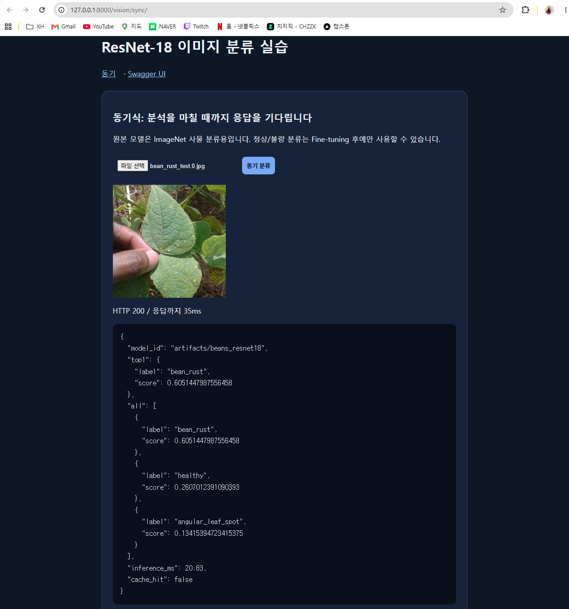
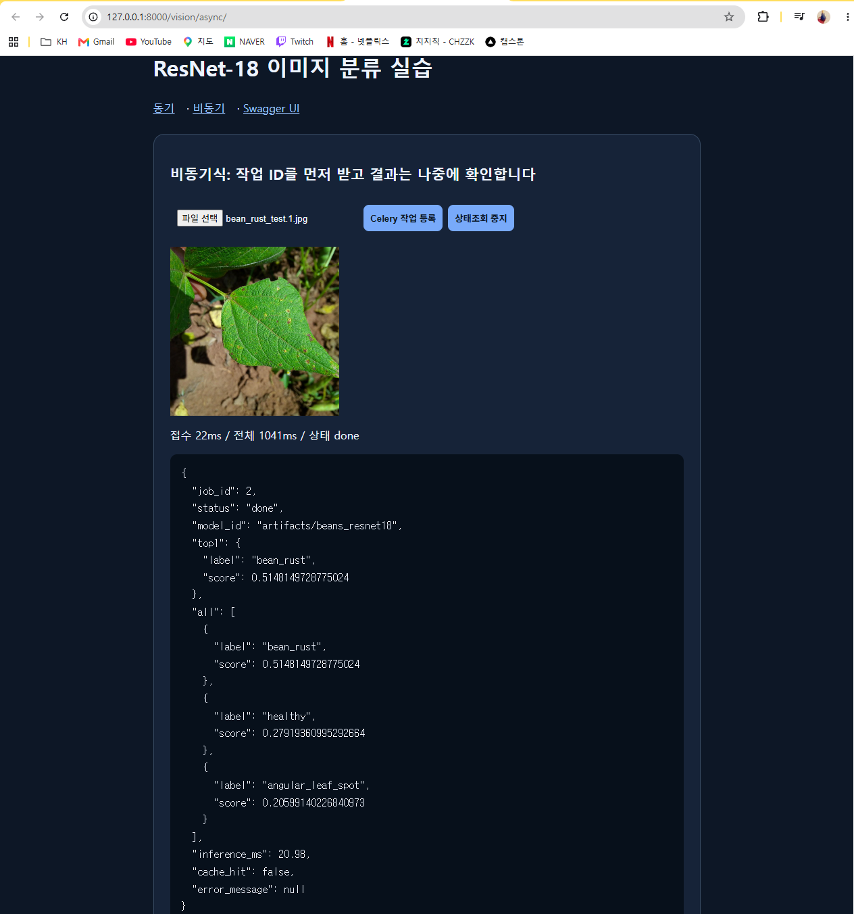
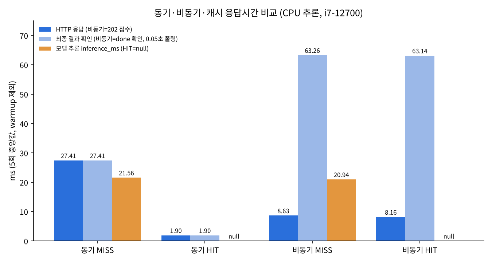
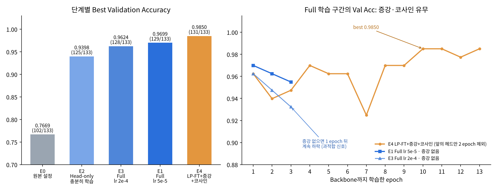
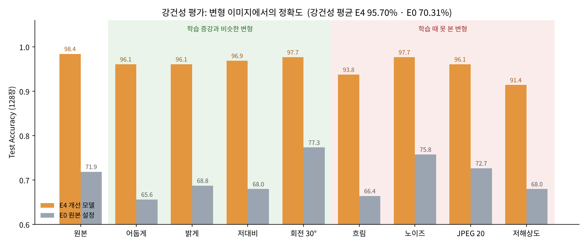
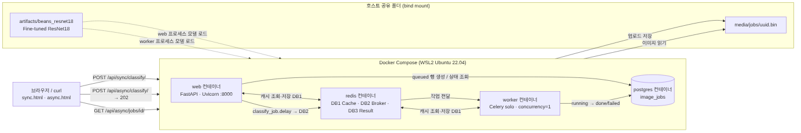

<div align="center">

# 🌱 Plant Disease Vision API

**콩잎 사진 한 장으로 잎의 질병을 분류하는 AI 웹 서비스**

ResNet18을 콩잎 데이터로 Fine-tuning하고, FastAPI로 **동기 · 비동기** 두 방식으로 서빙합니다.


[빠른 시작](#-빠른-시작) · [결과](#-결과-한눈에-보기) · [성능 개선 과정](#-성능-개선-과정) · [API](#-api) · [보고서](#-문서산출물)

</div>

---

<details>
<summary><b>📑 목차</b></summary>

1. [프로젝트 소개](#-프로젝트-소개)
2. [주요 기능](#-주요-기능)
3. [데모](#-데모)
4. [결과 한눈에 보기](#-결과-한눈에-보기)
5. [성능 개선 과정](#-성능-개선-과정)
6. [시스템 아키텍처](#-시스템-아키텍처)
7. [기술 스택](#-기술-스택)
8. [빠른 시작](#-빠른-시작)
9. [API](#-api)
10. [테스트와 성능 측정](#-테스트와-성능-측정)
11. [프로젝트 구조](#-프로젝트-구조)
12. [문서(산출물)](#-문서산출물)
13. [트러블슈팅](#-트러블슈팅)
14. [한계와 향후 과제](#-한계와-향후-과제)
15. [참고 논문](#-참고-논문)
16. [출처와 라이선스](#-출처와-라이선스)

</details>

## 📌 프로젝트 소개

콩잎 사진을 올리면 아래 **3개 클래스** 중 하나로 분류합니다(이미지 분류. 병반의 위치를 찾는 객체 검출은 범위에 넣지 않았습니다).

| 클래스 | 의미 |
|---|---|
| `angular_leaf_spot` | 각진잎반점병 |
| `bean_rust` | 콩 녹병 |
| `healthy` | 정상 |

**핵심 내용**

- ImageNet 1,000클래스로 사전학습된 `microsoft/resnet-18`의 출력층을 **3클래스로 교체**하고 콩잎 데이터로 추가 학습했습니다.
- 같은 모델을 **동기 API**(결과까지 바로 응답)와 **비동기 API**(접수 후 Celery worker가 처리)로 서빙하고, 두 방식의 응답 시간을 **실측으로 비교**했습니다.
- **Redis 캐시**로 같은 이미지에 대한 추론을 생략하고, **PostgreSQL**에 비동기 작업 이력을 남깁니다.

## ✨ 주요 기능

- 🧠 **Fine-tuning과 성능 개선** — 제공 코드의 약점을 하나씩 찾아 고쳐 Test 정확도 **0.7188 → 0.9844**, 변형 이미지에서도 평균 0.9570
- ⚡ **동기 분류** — `POST /api/sync/classify/` → 200 + 결과
- 📨 **비동기 분류** — `POST /api/async/classify/` → 202 + `job_id` → 상태 조회로 결과 확인
- 🗃️ **Redis 캐시** — 이미지 내용(sha256)과 모델 경로 기준으로 600초 동안 결과 재사용, 캐시 · 브로커 · 결과를 DB 번호로 분리
- 🧾 **작업 이력** — `image_jobs` 테이블에 `queued → running → done / failed` 상태 기록
- 🛡️ **입력 검증** — JPG · PNG · WEBP만 허용, 5MB 초과는 413, 잘못된 파일은 400
- 🐳 **한 번에 실행** — `docker compose up` 하나로 web · worker · Redis · PostgreSQL 기동

## 🎬 데모

| 동기 분류 (`/vision/sync/`) | 비동기 분류 (`/vision/async/`) |
|:---:|:---:|
|  |  |
| `bean_rust` 사진 → **bean_rust** 0.6051<br>결과까지 **35ms** | `bean_rust` 사진 → **bean_rust** 0.5148<br>접수 **22ms** → 1초 간격 조회로 done 확인 |

## 📊 결과 한눈에 보기

### 모델

| 모델 | Validation (133장) | **Test (128장)** | Macro F1 (Test) | 강건성 평균 | 상태 |
|---|---:|---:|---:|---:|---|
| E0 제공 코드 그대로 | 0.7669 | 0.7188 | 0.7109 | 0.7031 | 필수 실험 · 산출물 2~7 측정에 사용 |
| **E4 개선 모델** | **0.9850** | **0.9844** | **0.9845** | **0.9570** | **최종 모델 · 현재 서비스에 연결됨** |

- **Test 기준 +26.56%p** (정답 92 → 126장). Test는 최종 모델을 Val로 정한 뒤 **한 번만** 평가했습니다.
- E4는 Val(0.9850)과 Test(0.9844)가 거의 같아서, **Validation에 맞춰 고른 점수가 아니라는 것**도 확인했습니다.
- 틀린 2장은 모두 **각진잎반점병 ↔ 녹병** 사이였고, 정상 잎(healthy)은 42장 모두 맞혔습니다.
- **강건성 평균**은 Test 사진에 밝기 · 흐림 · 노이즈 · 저해상도 등 8가지 변형을 줬을 때의 평균 정확도입니다.

무엇이 약했고 어떻게 고쳤는지는 바로 아래 [성능 개선 과정](#-성능-개선-과정)에 단계별로 정리했습니다.

### 응답 시간 (5회 중앙값, CPU 추론)

| 경로 | 캐시 | HTTP 응답 | 결과 확인까지 | 모델 추론 |
|---|:---:|---:|---:|---:|
| 동기 | MISS | 27.41 ms | 27.41 ms | 21.56 ms |
| 동기 | HIT | **1.90 ms** | 1.90 ms | 생략 |
| 비동기 | MISS | **8.63 ms** (202 접수) | 63.26 ms | 20.94 ms |
| 비동기 | HIT | 8.16 ms (202 접수) | 63.14 ms | 생략 |

- **캐시 HIT → 응답 93.07% 감소**: 같은 이미지는 추론을 건너뜁니다.
- **비동기 접수 → 동기보다 68.52% 빠른 응답**: 추론이 빨라진 게 아니라, 접수와 처리를 분리한 효과입니다.
- **결과를 받기까지는 비동기가 35.85ms 더 느립니다**: 큐 · DB · 상태 조회 비용 때문입니다.



자세한 내용 → [산출물 6](reports/06_성능비교_보고서.md)

## 🔬 성능 개선 과정

제공 코드 그대로는 Val Acc **0.7669**였습니다. 원인을 하나씩 가설로 세우고 실험으로 확인해 **0.9850**까지 올렸습니다.



| 단계 | 찾은 약점 | 대응 | Best Val Acc |
|:---:|---|---|---:|
| 0 | — | 제공 코드 그대로 (Head-only, lr 0.0002, 3 epoch) | 0.7669 |
| 1 | 학습이 덜 됨 (loss 0.71에서 멈춤) | 학습률 ↑ · epoch ↑ | 0.9398 |
| 2 | Backbone이 콩잎 특징을 모름 | Backbone까지 학습 | 0.9699 |
| 3 | BatchNorm 통계가 학습 중 흔들림 | 코드 테스트로 확인, `--freeze-bn` 옵션 추가 | (실험 예정) |
| 4 | 과적합 방지 장치가 없음 | LP-FT + 데이터 증강 + 코사인 학습률 | **0.9850** (Test 0.9844) |

- 원인 1 **덜 학습된 것**(+17.29%p)과 2 **Backbone 고정**(학습률을 같게 두고 비교하면 +19.55%p)이 비슷하게 컸습니다.
- 증강이 없으면 Full 학습이 epoch 1 이후 계속 나빠졌는데(과적합 신호), 증강과 코사인 학습률을 쓰자 후반까지 유지·상승했습니다. Train과 Val 차이도 2.62%p → 1.11%p로 줄었습니다.
- **Test(0.9844)와 강건성 평가**로 최종 확인했습니다. 가장 약한 변형은 <b>저해상도(−7.03%p)와 흐림(−4.69%p)</b>으로, 작은 반점 무늬가 지워지는 조건입니다.
- **서비스 모델을 E4로 교체**하고, E0이 틀렸던 사진 2장을 동기 · 비동기로 다시 보내 둘 다 맞히는 것을 확인했습니다([산출물 9의 7단계](reports/09_성능개선_실험보고서.md#7단계--서비스-모델을-e4로-교체하고-동작-확인)).
- ⚠️ 4는 기법 여러 개를 한꺼번에 적용해서 각각의 효과는 아직 분리하지 못했습니다.



실험 5개(E0 · E1 · E2 · E3 · E4) 전체 비교표 · Test 혼동행렬 · 클래스별 F1 → **[산출물 9 · 최종 모델 평가](reports/09_성능개선_실험보고서.md#최종-모델-평가--모든-실험-비교)**

약점별 원리 · 실험 조건 · Test · 강건성 평가 · 논문 근거 → **[산출물 9 성능 개선 실험 보고서](reports/09_성능개선_실험보고서.md)**

## 🏗️ 시스템 아키텍처



**🔵 동기** — 브라우저가 web에 이미지를 보내면, web이 Redis 캐시를 먼저 보고 없을 때만 ResNet18로 추론해서 **결과까지 한 번에** 돌려줍니다(200).

**🟠 비동기** — 그림의 번호 순서대로 진행됩니다.

| 단계 | 하는 일 |
|:---:|---|
| ① ② | 브라우저가 이미지를 보내면 web이 검증 · 저장 후 **바로 202와 `job_id`만** 돌려줌 |
| ③ ④ | web이 DB에 `queued` 행을 만들고, Redis 큐(DB 2)에 작업을 등록 |
| ⑤ ⑥ | worker가 작업을 꺼내 캐시(DB 1)를 확인하고, 없으면 ResNet18로 추론 |
| ⑦ | worker가 DB를 `done`과 결과로 갱신 |
| ⑧ | 브라우저가 `job_id`로 상태를 다시 물어보면 web이 DB를 조회해 응답 |

> 모델은 web과 worker가 **각자 따로 메모리에 불러옵니다**(첫 요청 약 2.3초, 이후 약 20ms). 함수 단위 처리 순서 → [산출물 5](reports/05_AI버튼_처리흐름.md) · 그림 원본 `reports/figures/architecture.svg`

## 🧰 기술 스택

| 구분 | 사용 기술 |
|---|---|
| 모델 · 학습 | Hugging Face Transformers, PyTorch, `microsoft/resnet-18` |
| API 서버 | FastAPI, Uvicorn, Jinja2 |
| 비동기 처리 | Celery(solo, concurrency=1), Redis |
| 데이터베이스 | PostgreSQL 17, SQLAlchemy 2.0 |
| 인프라 | Docker Compose (web · worker · redis · postgres) |
| 테스트 | pytest, FastAPI TestClient |
| 개발 환경 | Windows + WSL2 Ubuntu 22.04 · i7-12700 · RTX 3060(학습만 사용) |

## 🚀 빠른 시작

**준비물:** Docker Desktop(WSL Integration 켜기), Python 3.11, 학습용 GPU(선택)

### 1. 데이터 받기

```bash
mkdir -p ~/beans_source && cd ~/beans_source
for f in train validation test; do
  wget -O $f.zip https://huggingface.co/datasets/AI-Lab-Makerere/beans/resolve/main/data/$f.zip
done
unzip -q train.zip && unzip -q validation.zip && unzip -q test.zip

cd ~/fastapi_resnet18
mkdir -p dataset/{train,val,test}
cp -r ~/beans_source/train/*      dataset/train/
cp -r ~/beans_source/validation/* dataset/val/     # validation → val
cp -r ~/beans_source/test/*       dataset/test/
```

### 2. 모델 학습

```bash
python3.11 -m venv .venv && source .venv/bin/activate
pip install torch==2.5.1 torchvision==0.20.1 --index-url https://download.pytorch.org/whl/cu121
pip install -r requirements.txt

python -m training.finetune --data dataset --output artifacts/beans_resnet18 \
  --epochs 3 --batch-size 8 --freeze-backbone

cp .env.example .env        # MODEL_PATH=artifacts/beans_resnet18 (제공 코드 기준 모델)
```

<details>
<summary>개선 모델 학습 · 평가 · 서비스 교체 · Full Fine-tuning · GPU 없이 학습하기</summary>

```bash
# 개선 모델 (E4: LP-FT + 증강 + 코사인 학습률)
python -u -m training.finetune_v2 --output artifacts/e4_lpft_aug_cosine \
  --epochs 15 --batch-size 8 --lp-epochs 2 --lr 0.00005 --head-lr-mult 20 \
  --augment --scheduler cosine --warmup-epochs 1 --patience 5

# 평가 (정확도 · 클래스별 Precision/Recall/F1 · 혼동행렬 · 틀린 이미지 목록)
python -m training.evaluate --model artifacts/e4_lpft_aug_cosine --split test --out reports/data/eval_test_e4.json

# 강건성 평가 (밝기 · 흐림 · 노이즈 · JPEG · 저해상도 등 8가지 변형)
python -m training.robustness --model artifacts/e4_lpft_aug_cosine --split test --out reports/data/robustness_e4.json

# 서비스 모델을 개선 모델로 교체 (web · worker가 새 모델을 다시 불러옴)
sed -i 's#^MODEL_PATH=.*#MODEL_PATH=artifacts/e4_lpft_aug_cosine#' .env
docker compose up -d --force-recreate web worker

# Backbone까지 학습 (평가가이드 선택 실험, 별도 폴더에 저장)
python -m training.finetune --data dataset --output artifacts/beans_resnet18_full \
  --epochs 3 --batch-size 8 --lr 0.00005

# GPU가 없으면 컨테이너에서 학습 (CPU)
docker compose run --rm trainer
```
</details>

### 3. 서비스 실행

```bash
mkdir -p media/jobs
docker compose up -d --build
docker compose ps                    # 4개 Up, redis · postgres · web (healthy)
curl http://127.0.0.1:8000/health    # {"status":"ok"}
```

| 주소 | 내용 |
|---|---|
| http://127.0.0.1:8000/vision/sync/ | 동기 분류 화면 |
| http://127.0.0.1:8000/vision/async/ | 비동기 분류 화면 |
| http://127.0.0.1:8000/docs | Swagger API 문서 |

<details>
<summary>재시작 · 종료 · 모델 교체</summary>

```bash
docker compose logs -f --tail=100 web worker      # 로그
docker compose up -d --force-recreate web worker  # .env의 MODEL_PATH나 모델을 바꿨을 때
docker compose stop                               # 정지 (데이터 보존)
docker compose up -d                              # 다시 시작
```
`docker compose down -v`는 DB · Redis 데이터를 지우니 쓰지 마세요.
</details>

## 🔌 API

| Method | URL | 설명 | 성공 | 오류 |
|---|---|---|:---:|---|
| `GET` | `/health` | 서버 상태 | 200 | — |
| `POST` | `/api/sync/classify/` | 동기 분류 (`image` 파일) | 200 | 400 · 413 · 422 |
| `POST` | `/api/async/classify/` | 비동기 작업 접수 | **202** | 400 · 413 · 422 · 503 |
| `GET` | `/api/async/jobs/{job_id}/` | 작업 상태 · 결과 조회 | 200 | 404 |

```bash
IMG=dataset/test/healthy/healthy_test.39.jpg
curl -s -X POST -F "image=@$IMG" http://127.0.0.1:8000/api/sync/classify/
```

```json
{
  "model_id": "artifacts/beans_resnet18",
  "top1": {"label": "healthy", "score": 0.8066},
  "all": [
    {"label": "healthy", "score": 0.8066},
    {"label": "bean_rust", "score": 0.1229},
    {"label": "angular_leaf_spot", "score": 0.0705}
  ],
  "inference_ms": 2282.39,
  "cache_hit": false
}
```

<details>
<summary>비동기 요청 예시</summary>

```bash
curl -s -X POST -F "image=@$IMG" http://127.0.0.1:8000/api/async/classify/
# {"job_id":1,"status":"queued","check_url":"/api/async/jobs/1/"}   ← HTTP 202 (접수만)

curl -s http://127.0.0.1:8000/api/async/jobs/1/
# {"job_id":1,"status":"done","top1":{"label":"bean_rust","score":0.5152}, ... ,"cache_hit":false}
```
`202`는 **접수**, 상태 조회의 `"status": "done"`이 **완료**입니다. 캐시 HIT이면 `inference_ms`가 `null`입니다(0ms가 아니라 추론 생략).
</details>

전체 명세 → [산출물 3](reports/03_API_명세서.md) · DB 구조 → [산출물 4](reports/04_DB_구조_작업이력.md)

## 🧪 테스트와 성능 측정

```bash
# 모의 통합 테스트 (가짜 모델 · SQLite) → 4 passed
docker compose exec web python -m pytest -q tests/test_api.py

# 학습 · 평가 · 강건성 스크립트 단위 테스트 (작은 가짜 모델, 인터넷 불필요) → 10 passed
python -m pytest -q tests/test_training.py tests/test_robustness.py

# 동기 · 비동기 · 캐시 응답 시간 측정 → reports/data/timings.csv
python scripts/measure_timings.py
```

| 구분 | 결과 |
|---|---|
| 실환경 통합 테스트 | **23건 PASS** — 3클래스 분류, 202 → done, 400 · 404 · 413, 캐시 MISS → HIT, worker 정지 시 `queued` 유지 → 재시작 후 처리, Redis DB 역할, DB 스키마, Swagger |
| 모의 테스트 | 01 `1 passed` · 02 `4 passed` (503 · `failed` 기록 포함) |
| 학습 · 평가 코드 테스트 | `6 passed` — 지표 계산, 모든 옵션으로 학습 후 서비스 방식으로 로드, Backbone·BN 고정 확인, BN 통계 변화(약점 3 가설), 평가 값과 학습 기록 일치 |
| 강건성 코드 테스트 | `4 passed` — 변형이 크기를 유지하며 실제로 바뀌는지, 노이즈 재현성, 색조 변형 제외, 평균 계산 |
| 모델 Test 평가 | E4 **0.9844** (126/128) · Macro F1 0.9845 · 강건성 평균 0.9570 |
| 오류 기록 | 실제로 겪은 오류 9건의 원인 · 조치 · 재검증 |

자세한 내용 → [산출물 7](reports/07_기능테스트_오류분석.md)

## 📁 프로젝트 구조

```text
plant-disease-vision-api/
├── ai/                        # 서비스 코드
│   ├── config.py              #   환경 변수 · 경로 · 업로드 제한
│   ├── hf_model.py            #   ResNet18 로드 (프로세스당 1회)
│   ├── services.py            #   이미지 검증 · 추론 · 캐시 키
│   ├── cache_service.py       #   Redis 캐시 HIT/MISS
│   ├── database.py · models.py#   PostgreSQL 연결 · image_jobs 테이블
│   ├── celery_app.py · tasks.py   # Celery 설정 · 비동기 분류 작업
│   └── router_sync.py · router_async.py · router_web.py
├── training/
│   ├── finetune.py            # 제공 학습 코드 (수정 안 함)
│   ├── finetune_v2.py         # 개선 학습 (증강 · LP-FT · 코사인 등)
│   ├── evaluate.py            # 평가 (정확도 · F1 · 혼동행렬)
│   └── robustness.py          # 강건성 평가 (8가지 변형)
├── templates/ · static/       # 동기 · 비동기 화면
├── tests/
│   ├── test_api.py            # 통합 모의 테스트 (02)
│   ├── test_training.py       # 학습 · 평가 코드 테스트
│   └── test_robustness.py     # 강건성 평가 코드 테스트
├── test_api.py                # 동기 API 모의 테스트 (01)
├── scripts/measure_timings.py # 성능 측정
├── reports/                   # 산출물 1~9 · 증빙 · 그림 · 측정 원본
├── main.py                    # FastAPI 앱
├── Dockerfile · compose.yaml  # web · worker · redis · postgres (+ trainer)
└── requirements.txt · .env.example
```

`dataset/`, `artifacts/`(모델 가중치), `media/jobs/`(업로드 이미지), `.env`는 `.gitignore`로 저장소에서 제외했습니다.

## 📚 문서(산출물)

| # | 문서 | 내용 |
|:---:|---|---|
| 1 | [Fine-tuning 결과보고서](reports/01_FineTuning_결과보고서.md) | 데이터 구성 · 학습 설정 · Head-only vs Full 비교 |
| 2 | [시스템 아키텍처](reports/02_시스템_아키텍처.md) | 구성도 · 컴포넌트 역할 · 실행 환경 |
| 3 | [API 명세서](reports/03_API_명세서.md) | 요청 · 응답 · 상태코드 · 실행 근거 |
| 4 | [DB 구조 · 작업이력](reports/04_DB_구조_작업이력.md) | `image_jobs` ERD · 상태 전이 · 실제 행 |
| 5 | [AI 버튼 처리흐름](reports/05_AI버튼_처리흐름.md) | 동기 · 비동기 시퀀스도 · 코드 대응표 |
| 6 | [성능 비교 보고서](reports/06_성능비교_보고서.md) | 응답 시간 · 캐시 효과 · 측정 한계 |
| 7 | [기능 테스트 · 오류 분석](reports/07_기능테스트_오류분석.md) | 테스트 23건 · 오류 9건 |
| 8 | [최종 기술보고서](reports/08_최종기술보고서.md) | 전체 요약 · OpenCV 개선 제안 · 한계 |
| 9 | [성능 개선 실험 보고서](reports/09_성능개선_실험보고서.md) | 약점 4가지 · 실험 E0~E4 · Test · 강건성 · 논문 근거 |

증빙 캡처 `reports/evidence/` · 그림 `reports/figures/` · 측정 원본 `reports/data/`

## 🔧 트러블슈팅

| 증상 | 원인 | 해결 |
|---|---|---|
| `Duplicate dispatch rule for <built-in function intern>` | Ubuntu 22.04의 Python 3.11.0rc1 + 최신 torch | `torch==2.5.1`, `torchvision==0.20.1` 설치 |
| `pytest`에서 `No module named 'ai'` | `pytest`가 현재 폴더를 import 경로에 넣지 않음 | <b>`python -m pytest`</b>로 실행 |
| 비동기 작업이 계속 `queued` | worker 미실행 | `docker compose logs worker` 확인 후 `docker compose start worker` |
| 1,000개 ImageNet 라벨이 나옴 | `.env`가 원본 모델을 가리킴 | `MODEL_PATH=artifacts/beans_resnet18`(또는 개선 모델 `artifacts/e4_lpft_aug_cosine`) 후 web · worker 재생성 |
| `address already in use` | 8000 · 6379 · 5432 포트를 다른 프로그램이 사용 중 | 로컬 uvicorn 등 기존 프로그램 종료 |

## 🧭 한계와 향후 과제

**한계**

- 산출물 2~7의 API · DB · 응답 시간 측정은 **E0으로 진행한 기록**입니다. E4로 교체한 뒤에는 동작 확인만 했고, 응답 시간은 다시 재지 않았습니다(같은 ResNet18 구조라 추론 시간은 비슷할 것으로 보지만 측정하지는 않음).
- E4는 점수를 높게(0.99 이상) 내는 경우가 많지만, Test에서 `angular_leaf_spot_test.14.jpg`를 **0.96으로 확신하고 틀린** 사례가 있습니다. 점수가 높다고 항상 맞는 것은 아닙니다.
- 최종 모델(E4)도 <b>저해상도(0.9141)와 흐림(0.9375)</b>에서 정확도가 떨어집니다. 멀리서 찍거나 초점이 안 맞은 사진에 약합니다.
- Test는 128장, 한 번의 분할 · 한 개 seed 결과입니다. 데이터가 한 지역(우간다) 현장 사진이라 다른 환경에서의 성능은 알 수 없습니다.
- 단일 사용자의 순차 요청만 측정했고, 동시 요청 처리량은 측정하지 않았습니다.
- worker가 root 권한으로 실행되고, DB 비밀번호가 `compose.yaml`에 그대로 들어 있습니다. 로컬 실습 환경 기준입니다.

**향후 과제**

- [x] 학습률을 같게 두고 Backbone 고정 여부만 바꿔서 Full Fine-tuning 효과를 분리해 확인 (E3, +19.55%p)
- [x] 최종 모델(E4)을 Test 데이터로 1회 평가 (0.9844, Macro F1 0.9845)
- [x] 강건성 평가 (평균 0.9570)
- [ ] 흐림 · 저해상도 증강을 추가하고, 다른 변형으로 다시 공정하게 평가
- [x] 개선 모델(E4)을 서비스에 적용하고 동기 · 비동기 · DB 동작 확인
- [ ] E4 기준으로 응답 시간 재측정
- [ ] Grad-CAM으로 오분류 원인 분석 → OpenCV HSV · 잎 ROI 규칙 실험 (설계만 완료, [산출물 8의 8장](reports/08_최종기술보고서.md#8-교과-9-opencv-성능-개선-제안--설계-제안--미구현))
- [ ] 동시 요청 부하 테스트

## 📖 참고 논문

- Kornblith et al. *Do Better ImageNet Models Transfer Better?* CVPR 2019 — 고정 특징보다 Fine-tuning이 유리
- Kumar et al. *Fine-Tuning can Distort Pretrained Features and Underperform Out-of-Distribution.* ICLR 2022 — LP-FT
- Loshchilov & Hutter. *SGDR.* ICLR 2017 — 코사인 학습률
- Ochieng. *Transfer learning for classification of bean plant leaf diseases.* 2022 — 같은 Beans 분할에서 증강 + Fine-tuning이 최고

링크와 전체 목록 → [산출물 9](reports/09_성능개선_실험보고서.md#참고-논문)

## 📄 출처와 라이선스

| 항목 | 출처 | 라이선스(각 페이지 표기) |
|---|---|---|
| 모델 | [microsoft/resnet-18](https://huggingface.co/microsoft/resnet-18) | Apache-2.0 |
| 데이터 | [AI-Lab-Makerere/beans](https://huggingface.co/datasets/AI-Lab-Makerere/beans) | MIT |

데이터셋과 학습된 가중치는 저장소에 포함하지 않았습니다. 사용하거나 공유하기 전에 각 저장소의 이용 조건을 확인하세요.
