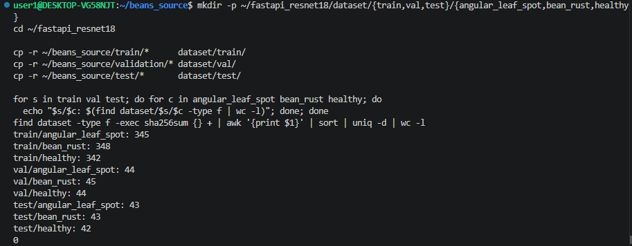
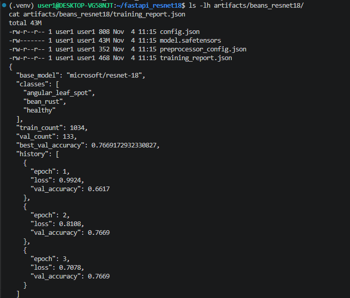
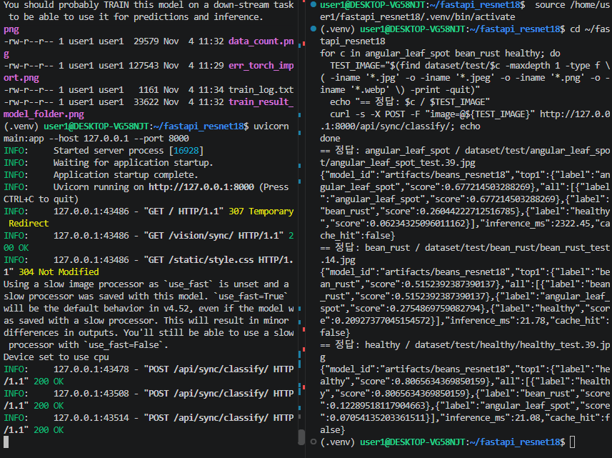
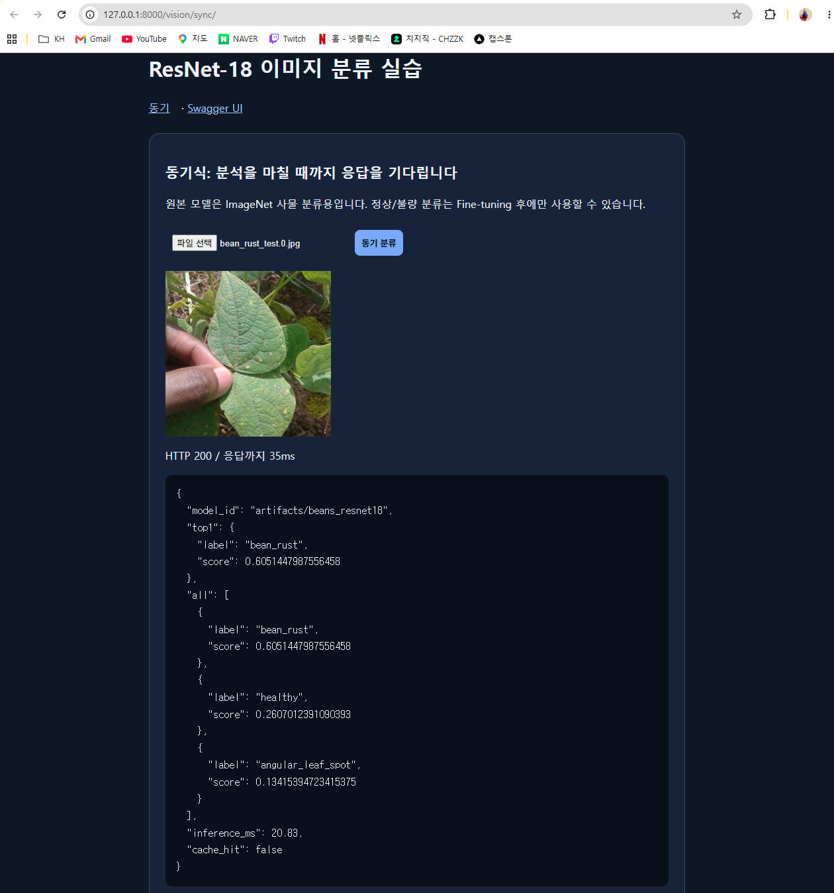
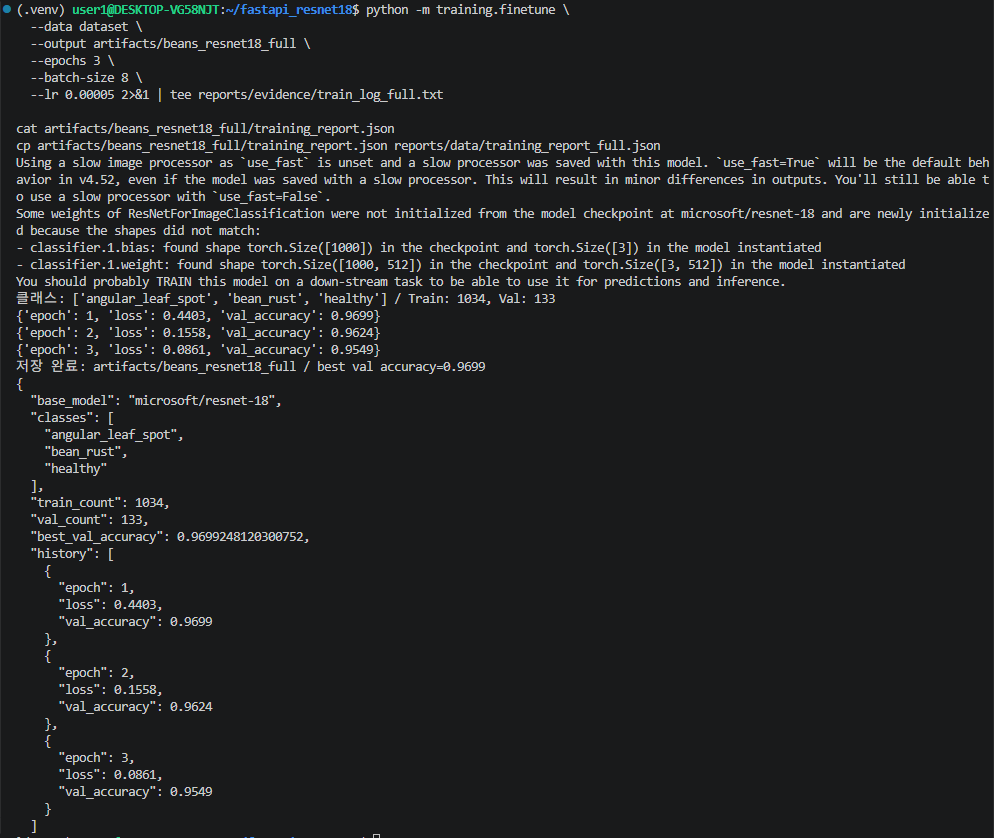

# 산출물 1. ResNet18 콩잎 3클래스 Fine-tuning 결과보고서

| 항목 | 내용 |
|---|---|
| 평가 대상 | 콩잎 이미지 3클래스 분류 (`angular_leaf_spot` · `bean_rust` · `healthy`) |
| 기준 모델 | [`microsoft/resnet-18`](https://huggingface.co/microsoft/resnet-18) (Task: image-classification, 라이선스 Apache-2.0) |
| 데이터셋 | [`AI-Lab-Makerere/beans`](https://huggingface.co/datasets/AI-Lab-Makerere/beans) (데이터셋 페이지 표기 라이선스 MIT) |
| 학습 방식 | **Head-only Fine-tuning** (`--freeze-backbone`, Backbone 고정 · 분류 헤드만 학습) |
| 학습 코드 | 01 문서 제공 `training/finetune.py` 원본 그대로 사용 (수정 없음) |
| 모델 저장 위치 | `artifacts/beans_resnet18/` |
| 실행일 · 환경 | 2026-11-04 · WSL2 Ubuntu 22.04 · Python 3.11.0rc1 · torch 2.5.1+cu121 · transformers 4.57.6 · RTX 3060 12GB (학습은 GPU) |
| 실험 상태 | **실행 완료** (동일 명령 2회 실행, 결과 동일) · 선택 실험 Full Fine-tuning도 실행 (§7) |
| 핵심 결과 | Head-only Best Val Acc **0.7669** (서비스 모델) / Full Fine-tuning **0.9699** (같은 Validation 133장) |

---

## 1. 데이터 준비와 구성

### 1-1. 다운로드와 폴더 매핑

HF 데이터 파일 3개를 WSL에서 직접 받았다. 원본 ZIP과 압축 해제본은 `~/beans_source/`에 그대로 두고, 제공 코드가 읽는 폴더로 **복사**해 배치했다.

```bash
wget -O train.zip      https://huggingface.co/datasets/AI-Lab-Makerere/beans/resolve/main/data/train.zip       # 138M
wget -O validation.zip https://huggingface.co/datasets/AI-Lab-Makerere/beans/resolve/main/data/validation.zip  # 18M
wget -O test.zip       https://huggingface.co/datasets/AI-Lab-Makerere/beans/resolve/main/data/test.zip        # 17M
```

| 원본 폴더 (`~/beans_source/`) | 코드 실행용 폴더 | 용도 |
|---|---|---|
| `train/` | `dataset/train/` | 가중치 학습 |
| `validation/` | **`dataset/val/`** | 학습 중 성능 확인 · best 모델 선택 (제공 코드가 `val` 이름을 읽음) |
| `test/` | `dataset/test/` | 학습에 사용하지 않음 (서비스 시연용 입력 이미지로만 사용) |

압축 해제 후 `train/train/` 같은 중첩 폴더가 생기지 않았음을 확인했다.

### 1-2. 클래스별 실제 이미지 수 (폴더 기준)

| 클래스 | Train | Validation | Test |
|---|---:|---:|---:|
| angular_leaf_spot | 345 | 44 | 43 |
| bean_rust | 348 | 45 | 43 |
| healthy | 342 | 44 | 42 |
| **합계** | **1,035** | **133** | **128** |



### 1-3. 학습에 실제로 반영된 수: Train 1,034장

| 구분 | Train | Validation |
|---|---:|---:|
| 폴더 내 파일 수 | 1,035 | 133 |
| 학습 코드 반영 수 (`training_report.json`) | **1,034** | 133 |

차이 1장의 원인을 추적했다.

```bash
find dataset/train -type f ! \( -iname '*.jpg' -o -iname '*.jpeg' -o -iname '*.png' -o -iname '*.webp' \)
# → dataset/train/healthy/healthy_train.120tore
```

원본 데이터에 확장자가 비정상인 파일(`healthy_train.120tore`)이 1개 들어 있고, 제공 코드의 확장자 필터(`EXTS = {".jpg", ".jpeg", ".png", ".webp"}`)가 이 파일을 제외했다. **원본 보존 원칙에 따라 파일을 수정하거나 이름을 바꾸지 않았다.** 그 결과 healthy 클래스의 실제 학습 수는 341장이다.

### 1-4. 데이터 누출 점검

| 점검 | 방법 | 결과 |
|---|---|---|
| 완전히 같은 파일의 split 간 중복 | `find dataset -type f -exec sha256sum {} +` 결과에서 중복 해시 개수 | **0개** |
| 거의 같은 사진(동일 잎의 다른 촬영 등) | 미점검 | 한계로 기록 (지각 해시 등 별도 도구 필요) |

정답 라벨은 사진을 보고 판단하지 않고 **제공 데이터의 폴더 이름**을 따랐다.

---

## 2. 실행 설정

```bash
python -m training.finetune \
  --data dataset \
  --output artifacts/beans_resnet18 \
  --epochs 3 \
  --batch-size 8 \
  --freeze-backbone 2>&1 | tee reports/evidence/train_log.txt
```

| 파라미터 | 값 | 비고 |
|---|---|---|
| base_model | microsoft/resnet-18 | ImageNet 1,000클래스 사전학습 |
| epochs | 3 | 01 문서 필수 명령 그대로 |
| batch_size | 8 | |
| learning_rate | 0.0002 | 제공 코드 기본값 (AdamW) |
| freeze_backbone | True | `classifier.`로 시작하는 파라미터만 `requires_grad=True` |
| seed | 42 | `random.seed(42)`, `torch.manual_seed(42)` |
| device | cuda (RTX 3060) | 서빙 추론은 `device=-1`로 CPU |
| output | artifacts/beans_resnet18 | |

### 출력층 교체 확인 (평가 지시사항 2번)

학습 로그에서 1,000클래스 ImageNet 출력층이 3클래스 출력층으로 바뀌어 새로 초기화된 것을 확인했다.

```text
Some weights of ResNetForImageClassification were not initialized from the model checkpoint at microsoft/resnet-18
and are newly initialized because the shapes did not match:
- classifier.1.bias: found shape torch.Size([1000]) in the checkpoint and torch.Size([3]) in the model instantiated
- classifier.1.weight: found shape torch.Size([1000, 512]) in the checkpoint and torch.Size([3, 512]) in the model instantiated
클래스: ['angular_leaf_spot', 'bean_rust', 'healthy'] / Train: 1034, Val: 133
```

이 경고는 오류가 아니라, 출력층 크기가 다르기 때문에(`ignore_mismatched_sizes=True`) 사전학습 가중치 대신 새 가중치로 시작한다는 뜻이다. Backbone(특징 추출부)은 사전학습 가중치를 그대로 쓰고 고정했다.

---

## 3. 학습 결과

| Epoch | Train Loss | Validation Accuracy | 정답 수 / 133 | 모델 저장 |
|---:|---:|---:|---:|:---:|
| 1 | 0.9924 | 0.6617 | 88 | 저장 |
| 2 | 0.8108 | **0.7669** | 102 | **저장 (best)** |
| 3 | 0.7078 | 0.7669 | 102 | 저장 안 함 |

- **Best Validation Accuracy: 0.7669 (= 0.7669172932330827, 102/133)**
- **저장된 모델은 epoch 2 가중치다.** 제공 코드가 `acc > best_acc`(이전보다 *높을 때만*)일 때만 저장하므로, 정확도가 같았던 epoch 3은 저장하지 않았다.
- Train Loss는 3 epoch 동안 계속 줄었고(0.99 → 0.71), Validation Accuracy는 epoch 2 이후 그대로였다. Backbone을 고정한 채 마지막 층만 학습한 한계로 보고, Backbone까지 학습하는 비교 실험을 §7에서 했다.
- **Test Accuracy:** 제공 코드에는 Test 평가 절차가 없다. 이후 별도 평가 스크립트(`training/evaluate.py`)로 측정한 E0의 Test 결과는 **0.7188 (92/128), Macro F1 0.7109**이다(산출물 9 §5단계).

### 재현성 확인

같은 명령을 두 번 실행했다. 첫 실행은 콘솔 로그를 저장하지 않아 증빙용으로 `tee`를 붙여 다시 실행했다. **두 번 모두 loss와 val_accuracy가 소수 넷째 자리까지 같았다.** seed 42 고정으로 결과가 재현됨을 확인했다. 제출한 모델과 로그, `training_report.json`은 모두 두 번째 실행에서 나온 것이다.

### `training_report.json` 원본 (`reports/data/training_report.json`)

```json
{
  "base_model": "microsoft/resnet-18",
  "classes": ["angular_leaf_spot", "bean_rust", "healthy"],
  "train_count": 1034,
  "val_count": 133,
  "best_val_accuracy": 0.7669172932330827,
  "history": [
    {"epoch": 1, "loss": 0.9924, "val_accuracy": 0.6617},
    {"epoch": 2, "loss": 0.8108, "val_accuracy": 0.7669},
    {"epoch": 3, "loss": 0.7078, "val_accuracy": 0.7669}
  ]
}
```

---

## 4. 생성 파일 확인

| 파일 | 크기 | 역할 |
|---|---:|---|
| `config.json` | 808 B | 3클래스 `id2label` · `label2id` 포함 모델 설정 |
| `model.safetensors` | 43 MB | 학습된 가중치 (epoch 2) |
| `preprocessor_config.json` | 352 B | 이미지 전처리 설정 |
| `training_report.json` | 468 B | 학습 기록 |



`artifacts/`는 용량 때문에 `.gitignore`로 저장소에서 제외했다. 수치 원본은 `reports/data/training_report.json`에 복사해 두었고, 학습 콘솔 로그는 `reports/evidence/train_log.txt`에 있다.

---

## 5. 서비스 연결 확인

`.env`에 `MODEL_PATH=artifacts/beans_resnet18`을 지정한 뒤, 학습에 쓰지 않은 `dataset/test` 이미지로 동기 API를 호출했다.

| 정답(폴더) | 입력 파일 | 예측 top1 | score | inference_ms | 일치 |
|---|---|---|---:|---:|:---:|
| angular_leaf_spot | angular_leaf_spot_test.39.jpg | angular_leaf_spot | 0.6772 | 2322.45 ※ | O |
| bean_rust | bean_rust_test.14.jpg | bean_rust | 0.5152 | 21.78 | O |
| healthy | healthy_test.39.jpg | healthy | 0.8066 | 21.08 | O |
| bean_rust (브라우저) | bean_rust_test.0.jpg | bean_rust | 0.6051 | 20.83 | O |

※ 첫 요청은 모델을 처음 불러오는 시간이 포함되어 느리다. 응답의 `model_id`가 `artifacts/beans_resnet18`이고 라벨이 3개 클래스로만 나오는 것으로, 원본 ImageNet 모델이 아니라 학습한 모델이 연결됐음을 확인했다.

> 위 4장은 **연결 확인용 표본**이며 정확도 평가가 아니다. 모델 성능은 Validation Accuracy 0.7669로만 주장한다.




Docker 통합 환경(CPU torch 2.5.1)에서도 같은 이미지에 대해 **라벨과 점수가 소수점까지 동일**하게 나왔다(산출물 3·7 참조).

---

## 6. 결과 판정

| 항목 | 판정 |
|---|---|
| 지정 데이터·폴더 구조 준비 | 완료 |
| 1,000클래스 → 3클래스 출력층 교체 | 완료 (학습 로그로 확인) |
| Head-only Fine-tuning 실행 · 모델 저장 | 완료 |
| `training_report.json` ↔ 보고서 수치 일치 | 일치 |
| FastAPI 동기 · 비동기 경로에 학습 모델 연결 | 완료 |
| 선택 실험 Full Fine-tuning | 실행 · Val Acc 0.9699 (§7) |
| Test 정량 평가 | E0 0.7188 · 개선 모델 E4 **0.9844** (산출물 9) |

**한계**
- 3 epoch Head-only 학습으로 Validation Accuracy 0.7669에 그쳤다. Backbone이 ImageNet 일반 사물 특징에 고정되어 있어 잎의 병반 같은 세밀한 차이를 충분히 반영하지 못했을 수 있다.
- Validation 133장의 단일 분할 결과라 통계적 불확실성이 있다(1장 차이 = 0.75%p).
- 거의 같은 사진의 split 간 누출은 점검하지 않았다.
- 2회 실행이 같은 결과였지만, GPU 연산 특성상 다른 환경에서 완전히 같다고 보장하지는 않는다.

---

## 7. 선택 실험 — Full Fine-tuning 비교 (실행 완료)

평가가이드 §6-1 B의 명령을 그대로 실행했다. **`training/finetune.py`는 수정하지 않았고** 실행 옵션만 바꿨다. 결과는 별도 폴더에 저장해 기준선(E0) 파일을 덮어쓰지 않았다.

```bash
python -m training.finetune \
  --data dataset \
  --output artifacts/beans_resnet18_full \
  --epochs 3 \
  --batch-size 8 \
  --lr 0.00005 2>&1 | tee reports/evidence/train_log_full.txt
```

### 7-1. 조건 비교

| 항목 | E0 Head-only | E1 Full Fine-tuning |
|---|---|---|
| `--freeze-backbone` | 사용 (분류 헤드만 학습) | **미사용 (전체 가중치 학습)** |
| learning rate | 0.0002 (기본값) | **0.00005** (전체 학습이라 낮게, 가이드 권장값) |
| epochs · batch · seed | 3 · 8 · 42 | 3 · 8 · 42 |
| 데이터 | Train 1,034 / Val 133 | **같은 분할** |
| 저장 폴더 | `artifacts/beans_resnet18` | `artifacts/beans_resnet18_full` |

### 7-2. Epoch별 결과

| Epoch | E0 Loss | E0 Val Acc | E1 Loss | E1 Val Acc (정답 수) |
|---:|---:|---:|---:|---:|
| 1 | 0.9924 | 0.6617 | 0.4403 | **0.9699 (129/133)** ← 저장 |
| 2 | 0.8108 | **0.7669** ← 저장 | 0.1558 | 0.9624 (128/133) |
| 3 | 0.7078 | 0.7669 | 0.0861 | 0.9549 (127/133) |

### 7-3. 비교 결과

| 실험 | 실행 | Best Validation Accuracy | 저장 모델 | 결론 |
|---|---|---:|---|---|
| E0: Head-only (기준선) | 실행 | 0.7669 (102/133) | epoch 2 | 기준선 · **서비스 모델** |
| E1: Full Fine-tuning | **실행** | **0.9699 (129/133)** | epoch 1 | 같은 Validation에서 **0.2030 (20.30%p) 상승**, 정답 27장 증가 |

원본: `data/training_report_full.json`, 로그: `evidence/train_log_full.txt`



### 7-4. 해석

- **Backbone까지 학습하자 정확도가 크게 올랐다.** ImageNet 일반 사물 특징에 고정된 Backbone으로는 병반·녹병 반점 같은 잎의 세밀한 차이를 구분하기 어려웠고, Backbone을 콩잎 데이터에 맞게 조정하자 첫 epoch부터 0.9699에 도달했다. §6에 적은 Head-only의 한계를 실험으로 확인한 결과다.
- **과적합 신호가 있다.** E1의 Train Loss는 0.4403 → 0.0861로 계속 줄었지만, Validation Accuracy는 0.9699 → 0.9624 → 0.9549로 조금씩 떨어졌다. 학습 데이터에 점점 맞춰지면서 처음 보는 데이터에 대한 성능이 줄어드는 패턴이다. 제공 코드가 Validation 기준 best(epoch 1)만 저장하므로, 저장된 모델은 가장 좋았던 시점의 것이다.

### 7-5. 비교의 한계 (반드시 함께 읽을 것)

- **두 가지 조건이 함께 바뀌었다.** Backbone 고정 여부와 학습률(0.0002 → 0.00005)이 동시에 달라서, 향상분 전부를 Backbone 학습 효과라고 분리해서 말할 수 없다. 같은 학습률로 한 가지만 바꾼 실험은 하지 않았다.
- **Validation으로 best epoch를 고른 값이라 실제보다 높게 추정됐을 수 있다.** E1의 Test는 측정하지 않았다(최종 모델을 E4로 정한 뒤 E4와 비교용 E0만 Test 평가함).
- 단일 실행(seed 42)이고 Validation이 133장이라 1장 차이가 0.75%p다.
- **서비스(동기·비동기 API)는 계속 E0 모델(`artifacts/beans_resnet18`)을 쓴다.** 산출물 2~7의 API·DB·성능 결과는 모두 E0 기준이다. E1으로 바꾸려면 `.env`의 `MODEL_PATH`를 바꾸고 `docker compose up -d --force-recreate web worker`를 실행한 뒤 다시 검증해야 한다(미실시).

---

## 8. 이후 성능 개선 (요약)

이 보고서의 두 실험 이후, 원인을 하나씩 확인하며 추가 실험(E2~E4)을 했다. 최종 모델 E4(LP-FT + 데이터 증강 + 코사인 학습률)는 **Val 0.9850 · Test 0.9844 · 강건성 평균 0.9570**이다. 전체 과정 → [산출물 9](09_성능개선_실험보고서.md)

---

## 증빙
- `evidence/data_count.png` — 클래스별 개수, sha256 중복 0
- `evidence/train_log.txt` — 학습 콘솔 로그(출력층 교체 경고 포함)
- `evidence/train_result_model_folder.png` — 모델 파일 4개와 training_report.json
- `data/training_report.json` — 학습 기록 원본 복사본
- `evidence/01_sync_curl.png`, `evidence/01_sync_ui.png` — 서비스 연결 확인
- `evidence/train_log_full.txt`, `evidence/train_result_full.png`, `data/training_report_full.json` — Full Fine-tuning 비교 실험
