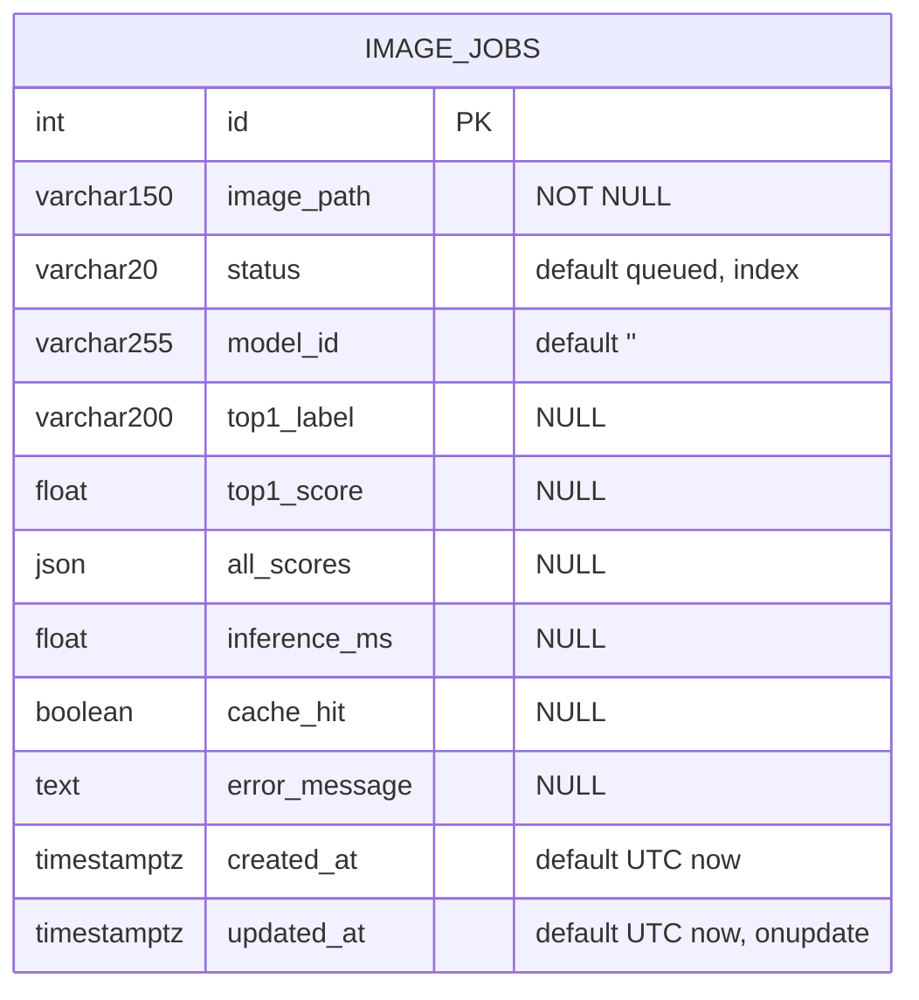
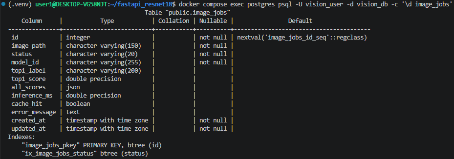
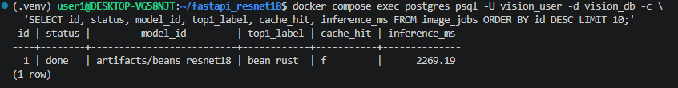
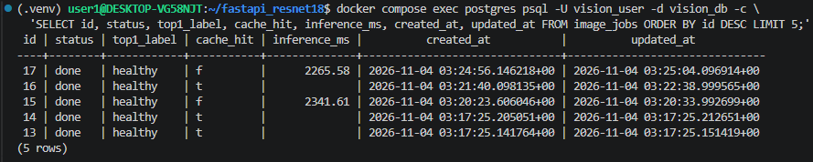
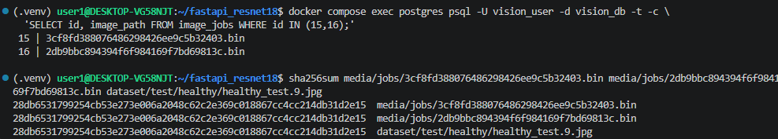

# 산출물 4. 데이터베이스 구조 및 작업이력

| 항목 | 내용 |
|---|---|
| DBMS | PostgreSQL 17 (`postgres:17-alpine`, Docker 볼륨 `postgres_data`) |
| 접속 | DB `vision_db` / 사용자 `vision_user` (컨테이너 안 호스트명 `postgres:5432`, 호스트에서는 `127.0.0.1:5432`) |
| 테이블 | **`image_jobs`** 1개 · PK `id` |
| 생성 방식 | web 시작 시 `main.py` lifespan → `ai.database.init_db()` → `Base.metadata.create_all()` |
| 저장 대상 | **비동기 작업**의 상태와 분류 결과 (동기 요청은 저장하지 않음) |
| ORM | SQLAlchemy 2.0 (`ai/models.py` · `ImageJob`) |

## 1. ERD



PNG: [`figures/erd.png`](figures/erd.png)

테이블이 하나뿐이라 FK나 관계 테이블은 없다.

## 2. 컬럼 정의 (제공 코드 `ai/models.py` 기준)

| 컬럼 | DB 자료형 | Nullable / 기본 | 실제 값 예시 | 사용 이유 · 기록 시점 |
|---|---|---|---|---|
| `id` | INTEGER | PK, 자동 증가 | `1` | 작업 번호 = 응답의 `job_id` |
| `image_path` | VARCHAR(150) | NOT NULL | `3cf8fd388076486298426ee9c5b32403.bin` | `media/jobs/` 안의 파일명. 접수 시 uuid로 생성, **사용자 파일명은 저장하지 않음** |
| `status` | VARCHAR(20) | NOT NULL, ORM 기본 `queued`, **index** | `done` | 상태 전이 추적. 조회가 잦아 인덱스 |
| `model_id` | VARCHAR(255) | NOT NULL, ORM 기본 `''` | `artifacts/beans_resnet18` | 어떤 모델로 처리했는지. 접수 시 `MODEL_PATH`, 완료 시 결과값으로 갱신 |
| `top1_label` | VARCHAR(200) | NULL | `bean_rust` | 최종 분류 라벨 (done일 때) |
| `top1_score` | FLOAT | NULL | `0.5152392387390137` | top1 점수 |
| `all_scores` | JSON | NULL | `[{"label":"bean_rust","score":0.515...}, ...]` | 3클래스 전체 점수. **API 응답에서는 `all`** |
| `inference_ms` | FLOAT | NULL | `2269.19` | 실제 추론 시간. **캐시 HIT이면 NULL** |
| `cache_hit` | BOOLEAN | NULL | `f` | worker가 Redis 캐시를 재사용했는지 |
| `error_message` | TEXT | NULL | NULL | 실패 원인 (`예외타입: 메시지`, 최대 1,500자) |
| `created_at` | TIMESTAMPTZ | NOT NULL, ORM 기본 UTC 현재 | `2026-11-04 03:24:56.146218+00` | 접수 시각 |
| `updated_at` | TIMESTAMPTZ | NOT NULL, ORM 기본 UTC 현재, 수정 시 갱신 | `2026-11-04 03:25:04.096914+00` | 마지막 상태 변경 시각 |

시각은 UTC로 저장된다(한국 시간 = UTC + 9시간).

### 실제 생성된 테이블 (`\d image_jobs`)

```text
                  Table "public.image_jobs"
    Column     |           Type           | Nullable |                Default
---------------+--------------------------+----------+----------------------------------------
 id            | integer                  | not null | nextval('image_jobs_id_seq'::regclass)
 image_path    | character varying(150)   | not null |
 status        | character varying(20)    | not null |
 model_id      | character varying(255)   | not null |
 top1_label    | character varying(200)   |          |
 top1_score    | double precision         |          |
 all_scores    | json                     |          |
 inference_ms  | double precision         |          |
 cache_hit     | boolean                  |          |
 error_message | text                     |          |
 created_at    | timestamp with time zone | not null |
 updated_at    | timestamp with time zone | not null |
Indexes:
    "image_jobs_pkey" PRIMARY KEY, btree (id)
    "ix_image_jobs_status" btree (status)
```

- 코드 정의와 실제 테이블이 일치한다(PK `id`, `status` 인덱스 `ix_image_jobs_status`).
- `status`, `model_id`, `created_at`, `updated_at`의 기본값(`queued`, `''`, 현재 시각)은 **DB가 아니라 SQLAlchemy가 INSERT할 때 채운다.** 그래서 DB의 Default 칸은 비어 있고 대신 `not null`로 만들어졌다. SQL로 직접 INSERT하면 이 값을 넣어 줘야 한다.



## 3. 상태 전이

```text
              접수(router_async)          worker 시작(tasks)          성공
  (없음) ───────────────────▶ queued ─────────────────▶ running ─────────▶ done
                              │                          │
                              │ 큐 등록 실패 → 503         │ 예외 → rollback 후
                              ▼                          ▼
                            failed                     failed (+ error_message)
```

| 전이 | 코드 위치 |
|---|---|
| → `queued` | `router_async.enqueue_classify()` — `ImageJob(status="queued")` INSERT |
| `queued` → `failed` | 같은 함수 — `classify_job.delay()` 예외 시 (HTTP 503) |
| `queued` → `running` | `tasks.classify_job()` 시작 시 commit |
| `running` → `done` | 결과 컬럼 채우고 commit |
| `running` → `failed` | 예외 시 `db.rollback()` → 다시 조회 → `failed` + `error_message` commit → 예외 다시 발생 |
| 이미 `done` | 다시 실행돼도 처리하지 않고 바로 반환 |

빠른 작업은 `running`이 약 20ms뿐이라 조회로 직접 보지 못했다. 정상 처리 여부는 최종 `done`, DB 행, worker 로그(`received` → `succeeded`)로 판단했다.

## 4. 조회 SQL

```bash
docker compose exec postgres psql -U vision_user -d vision_db -c \
  'SELECT id, status, model_id, top1_label, cache_hit, inference_ms FROM image_jobs ORDER BY id DESC LIMIT 10;'
```

```sql
SELECT id, status, top1_label, cache_hit, inference_ms, created_at, updated_at
FROM image_jobs
ORDER BY id DESC
LIMIT 5;
```

## 5. 실제 조회 결과

### 5-1. 첫 비동기 작업 직후 (동기 2회 + 비동기 1회 실행 뒤)

```text
 id | status |         model_id         | top1_label | cache_hit | inference_ms
----+--------+--------------------------+------------+-----------+--------------
  1 | done   | artifacts/beans_resnet18 | bean_rust  | f         |      2269.19
(1 row)
```

동기 요청 2건은 행을 만들지 않았고, 비동기 1건만 기록됐다.



### 5-2. 오류 테스트 이후 최근 5건

```text
 id | status | top1_label | cache_hit | inference_ms |          created_at           |          updated_at
----+--------+------------+-----------+--------------+-------------------------------+-------------------------------
 17 | done   | healthy    | f         |      2265.58 | 2026-11-04 03:24:56.146218+00 | 2026-11-04 03:25:04.096914+00
 16 | done   | healthy    | t         |              | 2026-11-04 03:21:40.098135+00 | 2026-11-04 03:22:38.995665+00
 15 | done   | healthy    | f         |      2341.61 | 2026-11-04 03:20:23.606046+00 | 2026-11-04 03:20:33.992699+00
 14 | done   | healthy    | t         |              | 2026-11-04 03:17:25.205051+00 | 2026-11-04 03:17:25.212651+00
 13 | done   | healthy    | t         |              | 2026-11-04 03:17:25.141764+00 | 2026-11-04 03:17:25.151419+00
(5 rows)
```



| id | 판정 | 해석 |
|---:|---|---|
| 17 | 비동기 추론 완료 (worker 정지 테스트) | worker 정지 중 접수 → 재시작 후 처리. **created→updated 약 7.95초** = 대기 시간. 재시작으로 모델을 다시 불러와 추론 2265.58ms |
| 16 | 캐시 결과 재사용 (worker 정지 테스트) | worker 정지 중 접수 → 재시작 후 처리(약 58.9초 대기). job 15와 **같은 이미지**라 HIT, `inference_ms` NULL |
| 15 | 비동기 추론 완료 | `healthy_test.9.jpg` 첫 처리(MISS) |
| 13·14 | 캐시 결과 재사용 | 성능 측정 스크립트의 비동기 HIT 회차 |

**job 15·16이 같은 이미지라는 확인** — 두 행의 `image_path` 파일과 원본을 sha256으로 비교해 3개 모두 `28db6531799254cb53e273e006a2048c62c2e369c018867cc4cc214db31d2e15`로 일치했다. 캐시 키는 이미지 **내용**의 해시라서, 업로드 파일명(uuid)이 달라도 HIT가 난다.



## 6. 저장 위치 정리

| 데이터 | 위치 |
|---|---|
| 작업 상태·결과 | PostgreSQL `image_jobs` |
| 업로드 이미지 원본 | `media/jobs/<uuid>.bin` (DB에 바이너리를 저장하지 않음, web·worker 공유 bind mount) |
| 분류 결과 캐시 | Redis DB1 (600초 TTL) |
| Celery 메시지 / 결과 | Redis DB2 / DB3 |
| 동기 요청 결과 | **DB에 저장하지 않음** (Redis 캐시에만 600초) |

## 7. `failed` 행

| 구분 | 결과 |
|---|---|
| 실환경(Docker) | **미발생** — 모든 작업이 `done` |
| 모의 테스트 | `test_worker_failure_records_failed`: 모델 예외 시 `status=failed`, `error_message`에 `fake model crashed` 기록 확인 (SQLite 임시 DB) |

실환경에서 `failed` 행을 관찰하지 못했으므로 있다고 주장하지 않는다.

## 8. 한계
- `media/jobs/`의 업로드 파일은 자동으로 지워지지 않는다(보관 정책 없음).
- 동기 요청은 이력이 남지 않아 사후 분석이 어렵다.
- `docker compose down -v`를 실행하면 `postgres_data` 볼륨이 삭제되어 이력이 모두 사라진다(평가 중 사용 금지).
