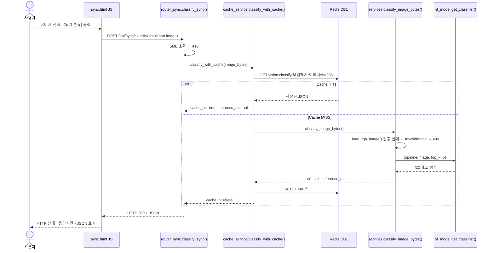
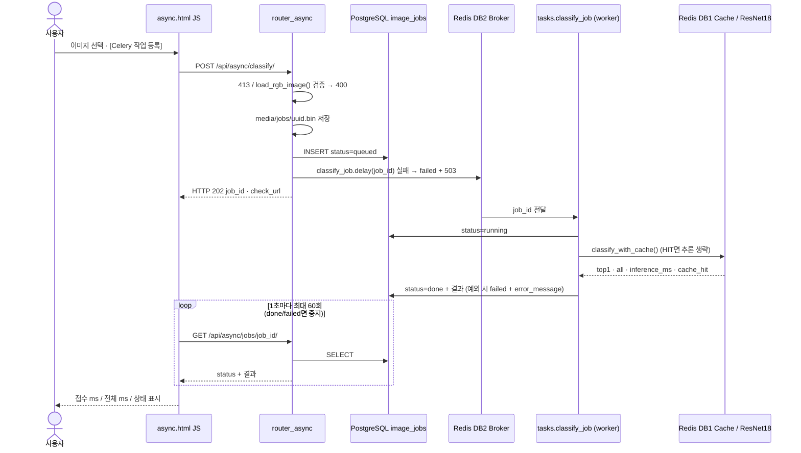
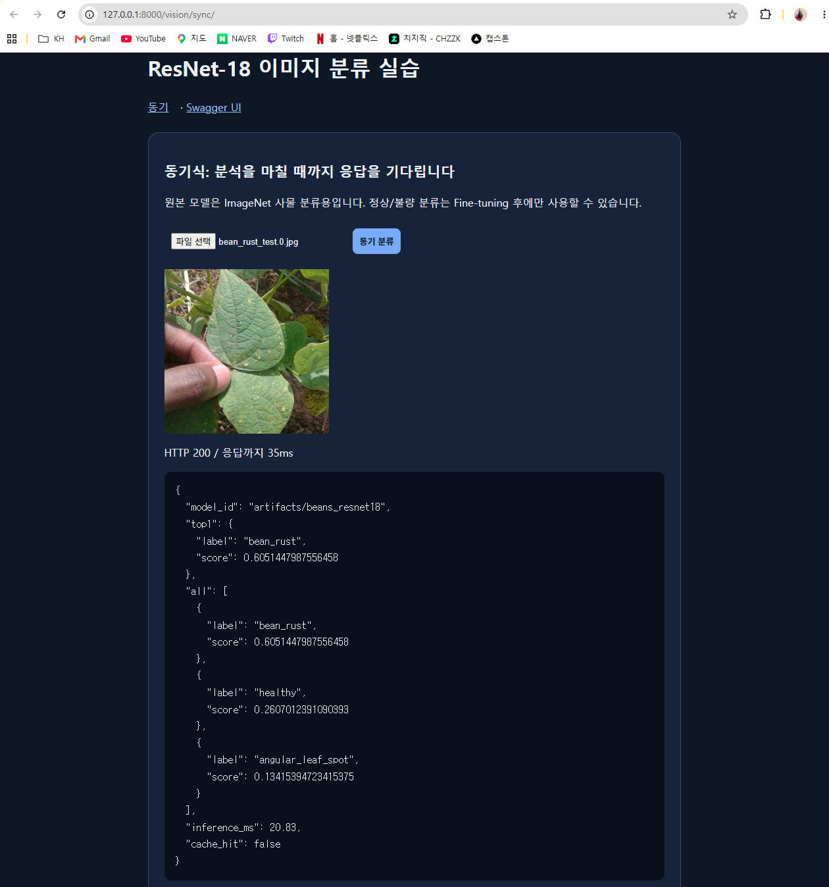
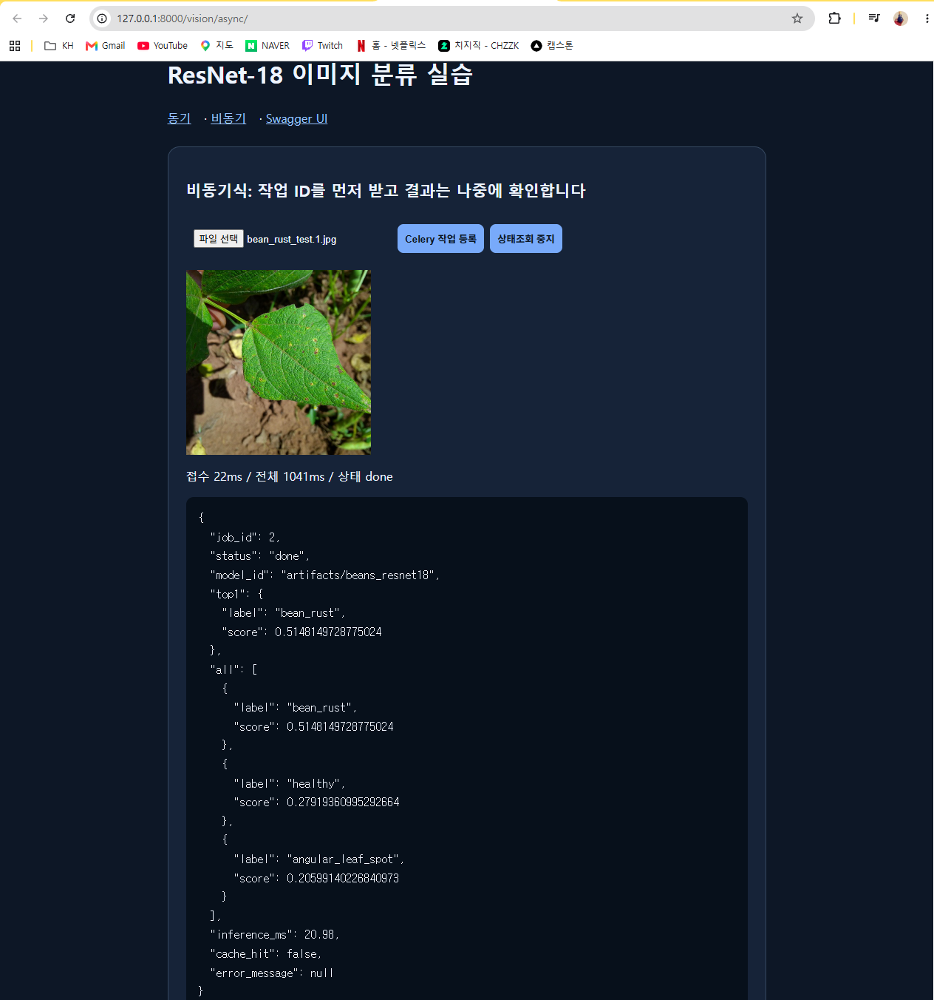

# 산출물 5. AI 분석 버튼 처리 파이프라인

사용자가 화면의 버튼을 누른 뒤 실행되는 파일·함수·데이터 흐름을 실제 코드 기준으로 정리했다.

## A. 동기 — `/vision/sync/`의 [동기 분류] 버튼



PNG: [`figures/sync_sequence.png`](figures/sync_sequence.png)

## B. 비동기 — `/vision/async/`의 [Celery 작업 등록] 버튼



PNG: [`figures/async_sequence.png`](figures/async_sequence.png)

[상태조회 중지] 버튼은 브라우저의 폴링만 멈춘다. worker의 작업은 계속 진행된다.

## C. 단계별 코드 대응표

| 단계 | 파일 | 함수 · 처리 | 결과 / 다음 단계 |
|---|---|---|---|
| 동기 1 | `templates/sync.html` | `FormData`에 `image` 추가 → `fetch('/api/sync/classify/')`, `performance.now()`로 시간 측정 | 응답 JSON과 `HTTP 200 / 응답까지 Nms` 표시 |
| 동기 2 | `ai/router_sync.py` | `classify_sync()` — `MAX_UPLOAD_BYTES + 1`만큼 읽어 5MB 초과면 413 | `classify_with_cache()` |
| 동기 3 | `ai/cache_service.py` | `cache_key()`(모델 경로 해시 16자 + 이미지 sha256) → `get_redis().get()` | HIT: 저장값 + `cache_hit=True`, `inference_ms=None` / MISS: 추론 |
| 동기 4 | `ai/services.py` | `load_rgb_image()` — 크기, 형식(JPEG/PNG/WEBP), 1,200만 픽셀, EXIF 회전, RGB 변환 | 실패 시 `InvalidImage` → 400 |
| 동기 5 | `ai/hf_model.py` · `ai/services.py` | `get_classifier()`(`lru_cache`, 프로세스당 1회 로드) → `pipeline(image, top_k=5)` → 점수순 정렬 | `top1`, `all`, `inference_ms` |
| 동기 6 | `ai/cache_service.py` | `setex(key, 600, json)` (Redis 장애 시 경고만 남기고 결과 반환) | HTTP 200 |
| 비동기 1 | `templates/async.html` | `fetch('/api/async/classify/')` → 접수 시간 기록 | `check_url` 1초 간격 폴링 |
| 비동기 2 | `ai/router_async.py` | `enqueue_classify()` — 413 · `load_rgb_image()` 400 검증 → `uuid4().hex + ".bin"` 저장 → `ImageJob(queued)` INSERT → `classify_job.delay()` | 202 `job_id` / 큐 실패 시 `failed` + 503 |
| 비동기 3 | `ai/celery_app.py` | 브로커 `redis/2`, 결과 `redis/3`, JSON 직렬화, `task_track_started=True` | worker에 메시지 전달 |
| 비동기 4 | `ai/tasks.py` | `classify_job(job_id)` — `running` commit → 파일 읽기 → `classify_with_cache()` → 결과 컬럼 기록 | `done` / 예외 시 `failed` + `error_message` |
| 비동기 5 | `ai/router_async.py` | `get_job()` — DB 조회, `done`일 때만 `top1`·`all`, `failed`일 때만 `error_message` | 상태 JSON / 없으면 404 |

## D. 실제 버튼 실행 결과

| 화면 | 입력 (정답 폴더) | 표시된 상태 | 결과 | 증빙 |
|---|---|---|---|---|
| 동기 | `bean_rust_test.0.jpg` (bean_rust) | `HTTP 200 / 응답까지 35ms` | bean_rust 0.6051, inference 20.83ms, MISS | `evidence/01_sync_ui.png` |
| 비동기 | `bean_rust_test.1.jpg` (bean_rust) | `접수 22ms / 전체 1041ms / 상태 done` | job 2, bean_rust 0.5148, inference 20.98ms, MISS | `evidence/02_async_ui.png` |




worker 로그에서 작업이 큐에서 꺼내져 처리된 것을 확인했다.

```text
[2026-11-04 03:25:01,800: INFO/MainProcess] Task ai.classify_job[9c4ff7a8-...] received
[2026-11-04 03:25:04,100: INFO/MainProcess] Task ai.classify_job[9c4ff7a8-...] succeeded in 2.2999s: {'job_id': 17, 'status': 'done'}
```

## E. 비교 결론

| 구분 | 동기 | 비동기 |
|---|---|---|
| HTTP 응답에 결과가 있나 | 있음 (200) | 없음 (202 접수만) |
| 결과 받는 방법 | 응답 한 번 | `check_url`을 다시 조회 |
| 브라우저 실측 | 35ms에 결과까지 | 22ms에 접수, 결과는 1,041ms에 확인 |
| 결과 확인이 늦은 이유 | — | 실제 추론은 20.98ms지만 **브라우저가 1초 간격으로 조회**하기 때문 |
| DB 기록 | 없음 | `image_jobs`에 상태·결과 |
| 분류 모델 | 같은 `artifacts/beans_resnet18` | 같음 (worker 프로세스가 따로 로드) |
| 적합한 상황 | 짧은 추론, 결과를 바로 보여 줄 때 | 오래 걸리는 작업, 요청을 바로 돌려줘야 할 때, 이력 관리 |

동기와 비동기는 <b>같은 ResNet18 모델과 같은 캐시 함수(`classify_with_cache`)</b>를 쓰고, 결과를 돌려주는 방식만 다르다.
