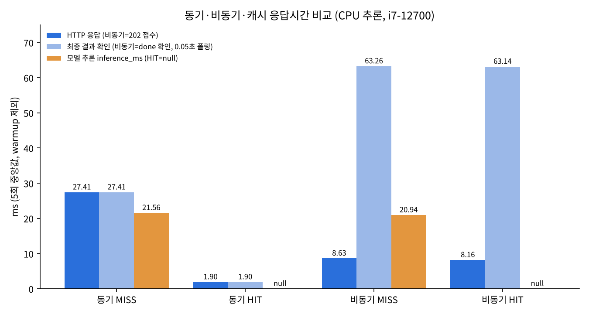

# 산출물 6. 성능 측정 및 비교 보고서

## 1. 실험 조건

| 조건 | 값 |
|---|---|
| 측정 도구 | `scripts/measure_timings.py` (제공 코드는 수정하지 않고 HTTP로만 측정, `httpx` + `time.perf_counter`) |
| 측정 위치 | WSL2 호스트 → `127.0.0.1:8000` (Docker web 컨테이너) |
| 모델 | `artifacts/beans_resnet18` (같은 체크포인트), 컨테이너 CPU 추론 |
| 하드웨어 | Intel i7-12700 (20 threads) · RAM 15 GiB(WSL) · GPU 미사용(서빙) |
| Worker | Celery `solo`, `concurrency=1` |
| 이미지 | `dataset/test`의 실제 콩잎 JPG, 3클래스를 번갈아 선택. 앞선 수동 검증에서 쓴 5장 제외, sha256으로 중복 제거 |
| 반복 | 조건별 **5회**, 요약은 **중앙값** |
| 캐시 | MISS 그룹 = 처음 보내는 서로 다른 5장 / HIT 그룹 = 같은 5장을 다시 전송. 동기와 비동기 MISS 이미지 집합은 겹치지 않게 분리(캐시를 공유하기 때문) |
| 워밍업 | 측정 전 동기·비동기 각 1회 실행, CSV에 `run_id=0, note=warmup`으로 남기고 **비교에서 제외** |
| 비동기 최종 시간 | 접수 요청 시작 → `done` 확인까지. **상태 조회(폴링) 시간 포함**, 조회 간격 0.05초 |
| 측정 시각 | 2026-11-04 12:17 (KST) |

**지표 정의**

| 지표 | 동기 | 비동기 |
|---|---|---|
| `http_ms` | 결과 JSON을 받을 때까지 | **202 접수 응답**을 받을 때까지 |
| `final_ms` | = `http_ms` | 접수 시작 → `done` 조회까지 (폴링 포함) |
| `inference_ms` | 서버가 기록한 모델 추론 시간 (HIT이면 null) | worker가 기록한 추론 시간 (HIT이면 null) |

## 2. 원본 측정표 (ms)

원본: [`data/timings.csv`](data/timings.csv) · 실행 화면: `evidence/06_timings_run.png`

### 동기
| 회차 | MISS http=final | MISS inference | 정답→예측 | HIT http=final | HIT inference |
|---:|---:|---:|---|---:|---:|
| warmup | 34.39 | 28.29 | angular_leaf_spot→angular_leaf_spot | — | — |
| 1 | 27.89 | 22.03 | healthy→healthy | 2.19 | null |
| 2 | 27.27 | 21.56 | angular_leaf_spot→angular_leaf_spot | 1.90 | null |
| 3 | 27.41 | 22.20 | bean_rust→bean_rust | 1.54 | null |
| 4 | 27.78 | 21.50 | healthy→healthy | 1.82 | null |
| 5 | 24.19 | 18.43 | angular_leaf_spot→angular_leaf_spot | 2.07 | null |
| **중앙값** | **27.41** | **21.56** | | **1.90** | null |

### 비동기
| 회차 | MISS 접수 http | MISS final | MISS inference | 정답→예측 | HIT 접수 http | HIT final |
|---:|---:|---:|---:|---|---:|---:|
| warmup | 11.93 | 66.05 | 19.33 | bean_rust→angular_leaf_spot | — | — |
| 1 | 8.54 | 62.72 | 20.39 | bean_rust→bean_rust | 10.86 | 68.35 |
| 2 | 9.50 | 63.91 | 19.50 | healthy→bean_rust | 8.11 | 63.02 |
| 3 | 8.63 | 63.26 | 24.25 | angular_leaf_spot→angular_leaf_spot | 11.36 | 64.52 |
| 4 | 9.01 | 63.66 | 20.94 | bean_rust→healthy | 8.16 | 62.96 |
| 5 | 8.22 | 62.10 | 21.19 | healthy→healthy | 8.08 | 63.14 |
| **중앙값** | **8.63** | **63.26** | **20.94** | | **8.16** | **63.14** |

- 비동기 10회 모두 `polls=1` — 첫 상태 조회(0.05초 뒤)에서 이미 `done`이었다.
- 캐시 HIT 확인: 동기 HIT 5/5, 비동기 HIT 5/5 (`cache_hit=true`, `inference_ms=null`). MISS 그룹은 0/5.
- 예측 일치는 참고용이다(같은 이미지를 반복해 셌고 표본이 작다). **모델 정확도는 Validation 0.7669로만 주장한다.**

## 3. 요약표 (중앙값, warmup 제외, 각 5회)

| 경로 | 캐시 | HTTP 응답 (ms) | 최종 결과 확인 (ms) | 모델 추론 (ms) |
|---|---|---:|---:|---:|
| 동기 | MISS | 27.41 | 27.41 | 21.56 |
| 동기 | HIT | 1.90 | 1.90 | null (생략) |
| 비동기 | MISS | 8.63 (접수) | 63.26 | 20.94 |
| 비동기 | HIT | 8.16 (접수) | 63.14 | null (생략) |



## 4. 계산

```text
① 캐시 효과 (동기 HIT vs MISS)
   (27.41 − 1.90) / 27.41 × 100 = 93.07 %   응답시간 감소

② 비동기 접수 vs 동기 응답 (MISS)
   (27.41 − 8.63) / 27.41 × 100 = 68.52 %   HTTP 응답시간 감소

③ 결과를 받기까지의 시간 (MISS)
   63.26 − 27.41 = 35.85 ms                 비동기가 더 느림

④ 모델 추론 자체 (MISS)
   동기 21.56 ms vs 비동기 20.94 ms           차이 0.62 ms (같은 모델, 같은 CPU 추론)
```

## 5. 해석

1. **캐시는 실제로 응답을 93.07% 줄였다.** HIT일 때는 모델 추론을 건너뛰기 때문이다(`inference_ms=null`). null은 0ms가 아니라 *추론을 하지 않았다*는 뜻이다. 남은 1.90ms는 업로드 전송, 이미지 해시 계산, Redis 조회 시간이다.
2. **비동기 접수가 동기보다 68.52% 빠르게 응답했지만, 모델이 빨라진 것이 아니다.** 추론 시간은 21.56 vs 20.94ms로 거의 같다. 접수(검증·파일 저장·DB INSERT·큐 등록)와 실제 처리를 분리했기 때문에 HTTP 응답만 먼저 돌아온 것이다.
3. **결과를 받기까지는 비동기가 35.85ms 더 걸렸다.** 큐 전달, worker의 DB 갱신 두 번(`running`, `done`), 상태 조회 요청이 더해지기 때문이다. 이번처럼 추론이 약 20ms로 짧으면 비동기의 이점은 "응답을 빨리 돌려준다"는 것뿐이고, 결과를 받는 데는 오히려 손해다.
4. **비동기 HIT가 최종 시간을 줄이지 못했다**(63.14 vs 63.26ms). worker 쪽 처리가 짧아진 것보다 조회 간격(0.05초)이 더 큰 영향을 줬기 때문이다. 아래 측정 한계 1번 참조.
5. **첫 요청(콜드 스타트)은 별도로 봐야 한다.** 모델을 처음 불러올 때 web 2282.39ms, worker 2269.19ms가 걸렸고, worker를 재시작한 뒤에도 2265.58ms였다(산출물 7). 위 측정은 모델이 이미 메모리에 있는 상태(warm)에서 했다. 워밍업 1회도 이미 warm 상태에서 실행됐으므로 콜드 스타트 값과 다르다.

## 6. 브라우저 측정 (참고, 별도 조건)

| 화면 | 표시 | 조회 간격 |
|---|---|---|
| `/vision/sync/` | `HTTP 200 / 응답까지 35ms` (inference 20.83ms) | — |
| `/vision/async/` | `접수 22ms / 전체 1041ms` (inference 20.98ms) | **1초** (`async.html` 고정) |

브라우저의 비동기 "전체 1041ms"는 작업이 끝난 뒤에도 첫 조회가 1초 뒤에 일어나기 때문이다. 스크립트 측정(0.05초 간격, 63ms)과는 조건이 달라 직접 비교하지 않는다.

## 7. 측정 한계

1. **비동기 final_ms는 실제 완료 시각이 아니라 상한값이다.** 10회 모두 첫 조회에서 이미 done이었으므로, 실제 완료는 접수 후 50ms보다 이르다. 조회 간격(50ms)이 측정 해상도의 하한이 됐다. 더 정확히 재려면 DB의 `created_at`/`updated_at` 차이나 worker 로그의 `succeeded in`(예: job 17 처리 2.2999초 중 대부분이 모델 로드)을 써야 한다.
2. 단일 사용자 · 순차 요청만 측정했다. 동시 요청이 많을 때 큐 대기나 처리량(throughput)은 측정하지 않았다. 이런 상황에서 비동기의 장점이 커질 수 있지만 **검증하지 않았으므로 주장하지 않는다.**
3. 조건별 5회로 표본이 작다. 동기 MISS 5회차(24.19ms)처럼 회차 간 편차가 있다.
4. 클라이언트가 같은 PC(WSL)라 네트워크 지연이 거의 없다. 실제 원격 환경에서는 HTTP 시간이 더 커진다.
5. 캐시 HIT 그룹은 MISS 직후 같은 이미지를 다시 보낸 것으로, 600초 TTL 안의 반복 요청 상황만 대표한다.

## 8. 비교 조건 점검

- [x] 같은 모델 체크포인트(`artifacts/beans_resnet18`)로 측정
- [x] MISS 대 MISS, HIT 대 HIT 구분 (`cache_hit` 값으로 5/5 확인)
- [x] 같은 데이터셋의 test 이미지 · 같은 하드웨어 · 같은 시점
- [x] 워밍업 표기 및 비교 제외, 콜드 스타트 값은 별도 기재
- [x] 비동기 최종 시간의 폴링 포함 여부와 간격 기재
- [x] 원본값(CSV)과 요약표 일치

> 비동기의 HTTP 접수시간과 모델 Accuracy는 서로 다른 지표다. 이 보고서의 수치는 응답 속도에 관한 것이며 분류 성능 향상을 뜻하지 않는다.
