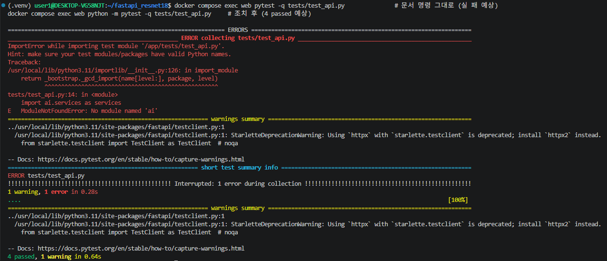
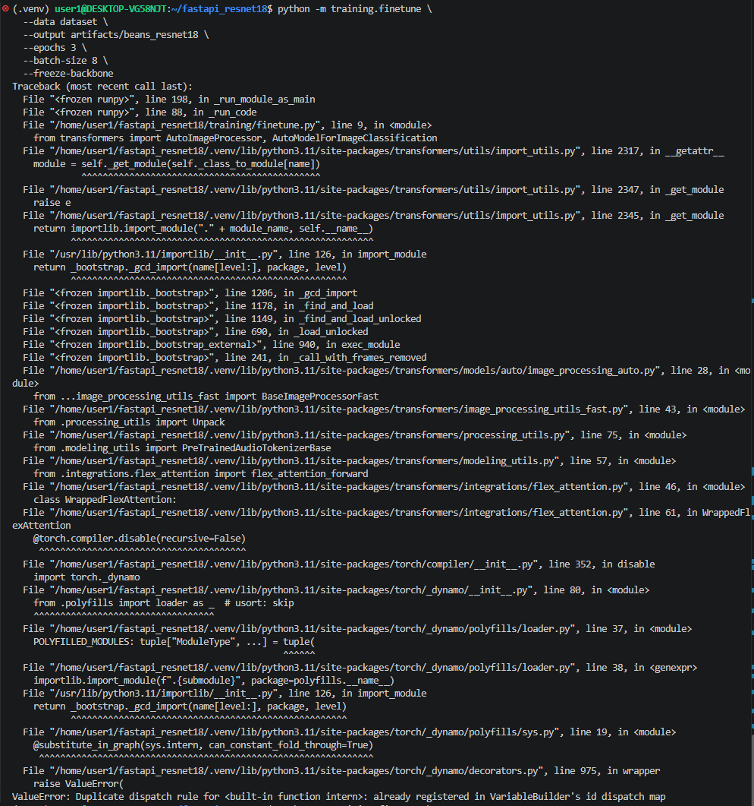

# 산출물 7. 기능 테스트 및 오류 분석 기록서

테스트는 두 종류로 나눠 기록한다. **같은 PASS로 섞어 쓰지 않는다.**

| 구분 | 의미 |
|---|---|
| **실환경 통합 테스트** | 실제 Fine-tuned ResNet18 · Redis · PostgreSQL · Celery(Docker)에 HTTP로 요청 |
| **모의 테스트** | 가짜 모델·가짜 Redis·SQLite 임시 DB로 HTTP 동작과 상태 전이만 확인 (pytest) |

## 1. 실환경 통합 테스트

| Test ID | 확인 항목 | 입력 · 절차 | 기대 결과 | 실제 결과 | 판정 | 증빙 |
|---|---|---|---|---|:---:|---|
| T-01 | FastAPI 헬스 | GET `/health` | 200 / ok | 200 `{"status":"ok"}` | PASS | `02_health_redis_pg.png` |
| T-02 | 동기 추론 (3클래스) | test 이미지 클래스별 1장 업로드 | 200 / 3클래스 라벨 | 200 ×3, 3장 모두 폴더 라벨과 일치 | PASS | `01_sync_curl.png` |
| T-03 | 비동기 접수 | `bean_rust_test.14.jpg` | 202 / job_id | 202 / job_id 1, queued | PASS | `02_async_202.png` |
| T-04 | 비동기 완료 | GET `/api/async/jobs/1/` | 200 / done | 200 / done, bean_rust 0.5152 | PASS | `02_async_job_done.png` |
| T-05 | Redis 연결 | `redis-cli ping` | PONG | PONG | PASS | `02_health_redis_pg.png` |
| T-06 | PostgreSQL · DB 기록 | `pg_isready`, `image_jobs` 조회 | accepting / id 1 done | accepting connections / id 1 done | PASS | `02_db_rows.png` |
| T-07 | 잘못된 입력 | `.txt` 업로드 | 400 | 400 "올바른 이미지 파일이 아닙니다." | PASS | `07_error_400_404_413.png` |
| T-08 | 없는 작업번호 | GET `/api/async/jobs/999999/` | 404 | 404 "해당 작업이 없습니다." | PASS | `07_error_400_404_413.png` |
| T-09 | 캐시 반복 | `healthy_test.39.jpg` 2회 | MISS → HIT | `cache_hit` false → true, `inference_ms` 2282.39 → null | PASS | `02_sync_cache_miss_hit.png` |
| T-10 | Worker 미실행 | worker 정지 → 접수 → 5초 후 조회 → worker 재시작 → 10초 후 조회 | queued 유지 → 재시작 후 처리 | job 17: queued → done, 로그 `received` → `succeeded` | PASS | `07_worker_stop_queued_done.png`, `07_worker_stop_db.png` |
| T-11 | 크기 초과 | 5.3MB 파일 업로드 | 413 | 413 "5MB 이하 파일만 허용합니다." | PASS | `07_error_400_404_413.png` |
| T-12 | Docker 4개 서비스 기동 | `docker compose up -d --build` | 4개 Up, healthy | postgres·redis·web healthy, worker Up · ready | PASS | `02_compose_ps_logs.png` |
| T-13 | 동기 화면 | `/vision/sync/`에서 업로드 | 200 · 결과 표시 | 35ms, bean_rust | PASS | `01_sync_ui.png` |
| T-14 | 비동기 화면 | `/vision/async/`에서 업로드 | 202 → done 표시 | 접수 22ms / 전체 1041ms / done | PASS | `02_async_ui.png` |
| T-15 | 동기 요청의 DB 미기록 | 동기 2회 후 `image_jobs` 조회 | 비동기 행만 존재 | 1 row (job 1) | PASS | `02_db_rows.png` |
| T-16 | 캐시 키가 내용 기준인지 | job 15·16 파일과 원본 sha256 비교 | 3개 동일 | 3개 모두 `28db6531…2e15` | PASS | `07_cache_hash_check.png` |
| T-17 | 학습 모델 연결 | 응답 `model_id`와 라벨 확인 | `artifacts/beans_resnet18`, 3클래스 | 일치 (ImageNet 1,000클래스 라벨 아님) | PASS | `01_sync_curl.png` |
| T-18 | DB 스키마 | `\d image_jobs` | 코드 정의와 같은 12개 컬럼 · PK · status 인덱스 | 일치 | PASS | `04_db_schema.png` |
| T-19 | Redis DB 역할 분리 | 동기 1회 후 `--scan`, `TTL`, `INFO keyspace` | DB1 캐시(TTL 600) · DB2 브로커 · DB3 결과 | db1 keys=1 TTL 600 / db2 keys=5 / db3 keys=17 | PASS | `02_redis_cache_keys.png` |
| T-20 | Swagger 문서 | `/docs` | 4개 API · 화면 경로 표시 | 실습 화면 2 · 동기 1 · 비동기 2 · health | PASS | `03_swagger_list.png` |
| T-21 | Swagger 동기 실행 | Try it out · `bean_rust_test.41.jpg` | 200 · 3클래스 JSON | 200 · **healthy 0.4867 (정답 bean_rust, 오분류)** | PASS (API) | `03_swagger_sync.png` |
| T-22 | Swagger 비동기 실행 | 접수 → job_id 18 조회 | 202 → 200 done | 202 → done, healthy 0.6793 | PASS | `03_swagger_async_202.png`, `03_swagger_async_done.png` |
| T-23 | 서비스 모델 교체 (E4) | `.env` 변경 → `--force-recreate web worker` → E0이 틀렸던 사진으로 동기 · 비동기 요청 | 4개 Up, 두 사진 모두 정답, DB `model_id` 갱신 | 동기 bean_rust 0.9999 · 비동기 job 19 angular_leaf_spot 0.9986 · `model_id = artifacts/e4_lpft_aug_cosine` | PASS | `service_e4_verify.png` |

**T-21 오분류 기록:** API 동작은 정상이지만 모델 예측은 틀렸다(정답 bean_rust → 예측 healthy, 점수 0.4867로 낮음). 서비스 모델(Head-only, Val Acc 0.7669)의 한계로 보며, 같은 Validation에서 Full Fine-tuning이 0.9699였다(산출물 1 §7). 이 이미지를 Full 모델로 다시 확인하지는 않았다.

**참고:** T-22의 inference_ms는 56.59ms로 측정 때(약 20ms)보다 컸다. 한동안 요청이 없던 뒤의 첫 요청이라 CPU 상태 영향으로 보이며, 원인을 따로 검증하지는 않았다.

**T-10 상세 (job 17)**

```text
docker compose stop worker                 → Container fastapi_resnet18-worker-1 Stopped
POST /api/async/classify/ (healthy_test.8)  → {"job_id":17,"status":"queued", ...}
5초 후 GET /api/async/jobs/17/              → "status":"queued", "top1":null
docker compose start worker                 → worker-1 Started
worker 로그  03:25:01,797 celery@... ready.
            03:25:01,800 Task ai.classify_job[9c4ff7a8-...] received
            03:25:04,100 Task ai.classify_job[9c4ff7a8-...] succeeded in 2.2999s: {'job_id': 17, 'status': 'done'}
10초 후 GET /api/async/jobs/17/             → "status":"done", healthy 0.7570, inference_ms 2265.58
DB  created_at 03:24:56.146 → updated_at 03:25:04.097 (약 7.95초)
```

worker가 멈춘 동안 작업은 Redis 브로커 큐에 남아 있었고, 재시작하자 바로 처리됐다. 다만 이것은 이번 환경(Redis AOF 사용, 짧은 정지)의 관찰 결과이며 **재시작하면 기존 작업이 항상 처리된다고 보장하지는 않는다.** 그래서 매번 로그와 DB 상태로 확인해야 한다.

## 2. 모의 테스트

| 명령 | 결과 |
|---|---|
| 01: `pytest -q test_api.py` (로컬 `.venv`) | **1 passed** |
| 02: `docker compose exec web python -m pytest -q tests/test_api.py` | **4 passed** |
| 성능 개선: `python -m pytest -q tests/test_training.py` | **6 passed** (학습 · 평가 스크립트) |
| 성능 개선: `python -m pytest -q tests/test_robustness.py tests/test_training.py` | **10 passed** (강건성 스크립트 4개 추가) |

| 테스트 함수 (02) | 확인 내용 |
|---|---|
| `test_end_to_end` | health · 화면 · CSS 200, 동기 200 · 400 · 413, 비동기 202 → queued → worker 함수 직접 호출 → done, 없는 작업 404 |
| `test_broker_failure` | 큐 등록 예외 시 503 |
| `test_cache_hit_avoids_repeated_inference` | 같은 바이트 2회 → 2번째 HIT, `inference_ms=None`, 추론 1회만 호출, TTL 600 |
| `test_worker_failure_records_failed` | 모델 예외 시 `status=failed`, `error_message`에 원인 기록 |

모의 테스트는 실제 모델 정확도와 실제 Docker·Redis·Celery 연결을 검증하지 않는다. 503과 `failed`는 **모의 테스트로만 확인**했고 실환경에서는 발생시키지 않았다.



## 3. 오류 이력 (실제로 겪은 것)

| 오류 ID | 현상 | 원인 확인 | 조치 | 재검증 | 결과 |
|---|---|---|---|---|---|
| E-01 | `unzip` 실행 시 `Command 'unzip' not found` | WSL Ubuntu에 unzip 미설치 | `sudo apt install -y unzip` | ZIP 3개 압축 해제, 클래스 폴더 확인 | 해결 |
| E-02 | `python3.11 -m venv .venv` → `Command 'python3.11' not found`, 이어서 `.venv/bin/activate` 없음 | Ubuntu 22.04 기본 Python이 3.11이 아님 | `sudo apt install -y python3.11 python3.11-venv` (설치 버전 3.11.0rc1) | `(.venv)` 활성화 확인 | 해결 |
| E-03 | 학습 실행 시 `ValueError: Duplicate dispatch rule for <built-in function intern>: already registered in VariableBuilder's id dispatch map` | `transformers` import 중 `torch._dynamo`에서 발생. 테스트판 Python **3.11.0rc1**과 최신 **torch 2.15.0+cu132** 조합 문제 | torch를 <b>2.5.1 / torchvision 0.20.1 (cu121)</b>로 교체. 02 `Dockerfile`이 고정한 버전과 같고 `requirements.txt` 범위(`torch>=2.3,<3`) 안 | import 확인 후 학습 재실행 | 해결, 학습 완료 |
| E-04 | 학습 로그 파일 `train_log.txt` 없음 | 첫 학습 때 `tee`를 붙이지 않아 콘솔 출력이 저장되지 않음 | 기존 모델 백업 후 같은 명령에 `2>&1 \| tee reports/evidence/train_log.txt`를 붙여 재학습 | loss · val_accuracy 1차와 소수 넷째 자리까지 동일 | 해결, 재현성 확인 |
| E-05 | `train_count` 1,034 ≠ 폴더 파일 1,035 | 원본의 `healthy_train.120tore`(비정상 확장자)가 코드의 확장자 필터에서 제외됨 | 원본 보존 원칙에 따라 수정하지 않고 보고서에 기록 | `find`로 확장자 외 파일 1개만 있음 확인 | 원인 규명 |
| E-06 | 02 §23 명령 `docker compose exec web pytest -q tests/test_api.py` → `ModuleNotFoundError: No module named 'ai'` | `pytest` 실행 파일은 현재 폴더(`/app`)를 import 경로에 넣지 않음. `tests/`에 `__init__.py`·설정 파일이 없어 테스트 폴더만 경로에 추가됨 | **코드 수정 없이** 실행 명령만 `python -m pytest -q tests/test_api.py`로 변경 (`python -m`은 현재 폴더를 경로에 추가) | 같은 컨테이너에서 재실행 | **4 passed** |
| E-07 | `git commit` → `fatal: not a git repository` | `git init` 전에 커밋 시도 | `git init -b main` 후 커밋 | `git log` 확인 | 해결 |
| E-08 | T-10 첫 시도에서 job 상태 조회 실패 `bash: job_id: No such file or directory` | 안내 명령의 `<job_id>` 자리 표시를 그대로 실행 → bash가 `<`를 입력 리다이렉션으로 해석 | job_id를 변수(`JOB=$(...)`)로 받아 자동 대입 | job 17로 재시험 | 해결 (T-10 PASS) |
| E-09 | 강건성 결과표에 `--5.46%p`처럼 부호가 두 번 찍힘 | 정확도가 원본보다 **올라간** 경우를 고려하지 않고 `-` 기호를 고정으로 붙임 (계산값 · JSON은 정상) | 변화량을 부호 포함 형식(`+5.46%p`)으로 출력하도록 수정 | 수정 후 `10 passed`, 같은 명령 재실행 | 해결 |



**미발생 · 미실시**
- 02 §25 오류표의 `address already in use`, `MODEL_PATH` 오류(ImageNet 라벨 출력), Worker에서 이미지 없음 — 미발생. 01 uvicorn을 먼저 종료하고 `.env`를 학습 경로로 설정했기 때문.
- 실환경 Redis 정지 시험, PostgreSQL 정지 시험 — 미실시.
- 실환경 `failed` 행 — 미발생 (모의 테스트로만 확인).

## 4. 경고 (오류 아님)

| 메시지 | 판단 |
|---|---|
| `Some weights of ResNetForImageClassification were not initialized ... newly initialized` | 1,000 → 3클래스 출력층 교체에 따른 정상 메시지 |
| `Using a slow image processor as use_fast is unset ...` | transformers 안내. 동작에 영향 없음, 제공 코드 유지 |
| Celery `SecurityWarning: You're running the worker with superuser privileges` | 제공 Dockerfile이 root로 실행. 동작에는 영향 없음, 운영 시 non-root 권장(한계) |
| pytest `StarletteDeprecationWarning`, anyio `DeprecationWarning` | 라이브러리 내부 경고, 결과에 영향 없음 |
| 터미널에 긴 코드를 붙여 넣을 때 화면 깨짐 | 표시 문제. `md5sum -c`로 02 파일 22개가 원본과 같음을 확인 |

## 5. 증빙 파일 (`reports/evidence/`)

| 파일 | 내용 |
|---|---|
| `02_compose_ps_logs.png` | 4개 서비스 상태, worker 기동 로그 |
| `02_health_redis_pg.png` | health, PONG, pg_isready |
| `02_sync_cache_miss_hit.png` | 동기 MISS → HIT |
| `02_async_202.png` · `02_async_job_done.png` | 비동기 202, done |
| `02_db_rows.png` | 첫 DB 행 |
| `02_pytest_fail_then_pass.png` | E-06 발생과 조치 후 4 passed |
| `07_error_400_404_413.png` | T-07 · T-08 · T-11 |
| `07_worker_stop_queued_done.png` · `07_worker_stop_db.png` | T-10 |
| `07_cache_hash_check.png` | T-16 |
| `04_db_schema.png` | T-18 |
| `service_e4_verify.png` | T-23 |
| `02_redis_cache_keys.png` | T-19 |
| `03_swagger_list.png` · `03_swagger_sync.png` · `03_swagger_async_202.png` · `03_swagger_async_done.png` | T-20 ~ T-22 |
| `err_torch_import.png` | E-03 |
| `01_sync_curl.png` · `01_sync_ui.png` · `02_async_ui.png` | 동기·비동기 화면 결과 |
