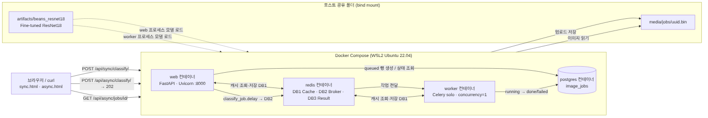
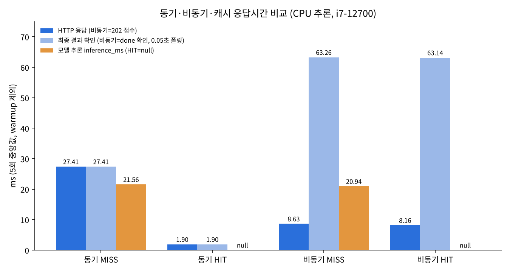

# 산출물 8. 콩잎 질병 분류 Vision AI API 서비스 최종 기술보고서

- 저장소: https://github.com/hxxdxm/plant-disease-vision-api
- 작성일: 2026-11-04 · 모든 수치는 직접 실행한 결과

## 1. 프로젝트 정보

| 항목 | 내용 |
|---|---|
| 프로젝트 | ResNet18 기반 Beans 3클래스 분류 및 FastAPI 동기·비동기 서빙 |
| 입력 | JPG / PNG / WEBP, 5MB 이하, 1,200만 픽셀 이하 |
| 출력 | `angular_leaf_spot`(각진잎반점병) / `bean_rust`(콩 녹병) / `healthy`(정상) + 점수 |
| 모델 | `microsoft/resnet-18` → Head-only Fine-tuning → `artifacts/beans_resnet18` |
| 실행 구조 | **Docker Compose: web(FastAPI) · worker(Celery) · Redis · PostgreSQL** (모두 컨테이너) |
| 개발 환경 | Windows + WSL2 Ubuntu 22.04 · i7-12700 · RAM 15GiB · RTX 3060 12GB(학습만) |
| 코드 | 01·02 문서 제공 코드를 그대로 사용 (md5로 원본 일치 확인). 측정용 `scripts/measure_timings.py`만 추가 |

## 2. 모델 학습 결과 요약

| 항목 | 결과 |
|---|---|
| 학습 방식 | **Head-only Fine-tuning** (Backbone 고정, `--freeze-backbone`) |
| 출력층 | 1,000클래스 → 3클래스 교체 (`classifier.1.weight` [1000,512] → [3,512]) |
| 데이터 | Train 1,034장(폴더 1,035, 비정상 확장자 1개 제외) · Validation 133장 · Test 128장(학습 미사용) |
| 설정 | epochs 3 · batch 8 · lr 0.0002 · seed 42 · GPU |
| Epoch별 Val Acc | 0.6617 → **0.7669** → 0.7669 |
| **Best Validation Accuracy** | **0.7669 (102/133)**, 저장 모델 = epoch 2 |
| 재현성 | 2회 실행 결과 동일 |
| **선택 실험 Full Fine-tuning** | Backbone까지 학습(lr 0.00005) → **Best Val Acc 0.9699 (129/133)**, 같은 Validation에서 +0.2030 (20.30%p) |
| **성능 개선 최종 모델 (E4)** | LP-FT + 데이터 증강 + 코사인 학습률 → **Val 0.9850 (131/133)** · **현재 서비스에 연결됨** (산출물 9) |
| Test 성능 | E0 0.7188 (92/128) · **개선 모델 E4 0.9844 (126/128), Macro F1 0.9845** |
| 강건성 평균 (8가지 변형) | E0 0.7031 · **E4 0.9570** |
| 모델 파일 | `artifacts/beans_resnet18/model.safetensors` (43MB) |

- 근거 문서: [산출물 1](01_FineTuning_결과보고서.md) · 성능 개선 전체 과정: [산출물 9](09_성능개선_실험보고서.md)
- 원본 기록: `data/training_report.json`, `evidence/train_log.txt`

## 3. 아키텍처 및 데이터 흐름

- **동기:** 브라우저 → web → Redis DB1 캐시(HIT면 바로 반환) → ResNet18 → 200 JSON
- **비동기:** 브라우저 → web(검증·파일 저장·DB queued) → Redis DB2 → worker → 캐시/ResNet18 → DB done → 브라우저가 상태 조회
- 모델은 **web과 worker 프로세스에서 각각 로드**된다(첫 추론 약 2.27~2.28초씩, 실측).
- 평가가이드 예시(FastAPI·Celery는 WSL)와 달리 **02 `compose.yaml`대로 전부 컨테이너**로 실행했다.
- 근거 문서: [산출물 2](02_시스템_아키텍처.md)

## 4. API · DB 설계

| API | 결과 |
|---|---|
| `GET /health` | 200 |
| `POST /api/sync/classify/` | 200 / 400 / 413 |
| `POST /api/async/classify/` | **202** / 400 / 413 / 503 |
| `GET /api/async/jobs/{id}/` | 200 / 404 |

- DB: PostgreSQL `image_jobs` 1개 테이블, 비동기 작업만 기록. 상태 `queued → running → done / failed`
- 업로드 이미지는 DB가 아니라 `media/jobs/<uuid>.bin`에 저장
- 근거 문서: [산출물 3](03_API_명세서.md) / [산출물 4](04_DB_구조_작업이력.md)

## 5. 버튼 처리 검증

| 화면 | 실측 |
|---|---|
| 동기 | `bean_rust_test.0.jpg` → bean_rust 0.6051, `HTTP 200 / 35ms` |
| 비동기 | `bean_rust_test.1.jpg` → 202 접수 22ms → done, 전체 1,041ms (1초 폴링) |

- 근거 문서: [산출물 5](05_AI버튼_처리흐름.md)

## 6. 실제 성능 비교 (5회 중앙값, warm 상태)

| 항목 | 값 |
|---:|---:|
| 동기 MISS 응답 | 27.41 ms (추론 21.56) |
| 동기 HIT 응답 | 1.90 ms (추론 생략) |
| 비동기 MISS 접수 | 8.63 ms |
| 비동기 MISS 결과 확인 (0.05초 폴링 포함) | 63.26 ms |
| 콜드 스타트(첫 모델 로드 포함 추론) | web 2282.39 ms / worker 2269.19 ms |

- **캐시:** 응답시간 **93.07% 감소** — 추론을 생략한 효과
- **비동기 접수:** 동기 응답보다 **68.52% 빠름** — 접수와 처리를 분리한 효과이며 **추론 가속은 아님**(21.56 vs 20.94ms)
- **결과 확인까지는 비동기가 35.85ms 더 느림** — 큐·DB·폴링 비용
- 비동기 최종 시간은 조회 간격(50ms)에 묶인 상한값이라는 측정 한계가 있다.
- 근거 문서: [산출물 6](06_성능비교_보고서.md), 원본 `data/timings.csv`

## 7. 기능 테스트 · 오류 조치

- **실환경 통합 테스트 23건 PASS** (Swagger 동기 1건은 API 정상·모델 오분류로 별도 기록) (health, 3클래스 동기, 202·done, Redis·DB, 400·404·413, 캐시 MISS→HIT, worker 정지 시 queued 유지 → 재시작 후 done, 캐시 키가 이미지 내용 기준임을 해시로 확인, Redis DB1·2·3 역할을 keyspace로 직접 확인, DB 스키마, Swagger 실행 등)
- **모의 테스트:** 01 `1 passed`, 02 `4 passed` (503·failed는 모의로만 확인)
- **실제로 겪은 오류 9건의 원인·조치·재검증 기록.** 대표 사례:
  - E-03 Python 3.11.0rc1 + torch 2.15 import 오류 → torch 2.5.1(02 Dockerfile과 같은 버전)로 해결
  - E-06 문서 명령 `pytest`가 `No module named 'ai'`로 실패 → 코드 수정 없이 `python -m pytest`로 4 passed
- 근거 문서: [산출물 7](07_기능테스트_오류분석.md)

## 8. 교과 9 OpenCV 성능 개선 제안 — **설계 제안 / 미구현**

관찰된 문제를 출발점으로 제안한다. **1번(Full Fine-tuning)과 2번(데이터 증강)은 실제로 실행해 측정했다(산출물 9). 3~7번은 구현하지 않았으므로 개선 수치를 주장하지 않는다.**

**관찰한 문제 (실측 근거)**
- 서비스 모델(Head-only)은 Validation Accuracy 0.7669로, 133장 중 31장을 틀렸다. → Full Fine-tuning으로 129/133까지 개선을 확인(1번).
- 측정용 표본에서 healthy → bean_rust, bean_rust → healthy처럼 **정상 잎과 녹병을 헷갈린 사례**가 있었다(산출물 6 §2).
- test 사진에 손, 흙, 다른 잎 같은 **배경**이 많이 들어 있다.
- top1 점수가 0.51~0.81 수준으로, 확신이 낮은 예측이 많다.

| 우선 | 제안 | 목표 · 처리 흐름 | 검증 방법 | 주의점 |
|:---:|---|---|---|---|
| 1 | **Full Fine-tuning 비교** (선택 실험, 코드 수정 불필요) — **실행 완료** | `--freeze-backbone` 없이 lr 0.00005로 `artifacts/beans_resnet18_full`에 별도 저장 | 같은 Validation 133장: **0.7669 → 0.9699** | epoch 2·3에서 Val Acc가 0.9624 → 0.9549로 떨어지는 과적합 신호. 학습률도 함께 바뀌어 효과를 분리할 수 없음 |
| 2 | **데이터 증강** — **실행 완료 (E4)** | 학습 데이터에만 반전·회전·밝기·대비 변화, 색조는 아주 조금만. LP-FT · 코사인 학습률과 함께 적용 | Val **0.9850** · Test **0.9844** · 강건성 평균 0.9570 | 여러 기법을 함께 적용해 증강만의 효과는 분리하지 못함. 흐림 · 저해상도에는 여전히 약함 |
| 3 | **HSV 병반 후보 면적비** | RGB→HSV → 잎 마스크 → 황색·갈색 후보 `inRange` → Opening/Closing → `ratio = 후보 픽셀 / 잎 픽셀` | Train으로 기준 설정, Validation으로 오탐 분석 | 흙(갈색)·햇빛·그림자에 임계값이 민감. 병명을 확정하는 근거가 아님 |
| 4 | **잎 ROI · 배경 제거** | GrabCut 또는 HSV 녹색 마스크로 잎만 남긴 입력을 별도로 학습 | 원본 입력과 같은 분할에서 비교 | 마스크 실패 시 병반이 잘려 정보 손실 |
| 5 | **Grad-CAM 오류 분석** | 오분류 사진에서 ResNet18이 손·흙을 보는지 확인 | 병반 위치와 히트맵 겹침 관찰 | **설명 도구일 뿐 정확도를 높이지 않음** |
| 6 | **CNN + 규칙 보류** | `top1.score`가 낮고 HSV 면적비와 충돌하면 라벨은 유지하고 `review_required` 표시 | 보류율과 보류되지 않은 예측의 정확도를 함께 보고 | 기본 API에 없는 확장 필드. 자동 분류 대상이 줄어듦 |
| 7 | **CNN + ML 융합** | 3클래스 점수 + HSV 통계 + Contour 개수·면적 → RandomForest 등 | Train 내부 교차검증으로 학습, Validation으로 선택, Test는 최종 1회 | 같은 잎의 비슷한 사진이 다른 split에 있으면 누출 |

**실험 결과 기록 양식 (현재 상태)**

| 실험 | 구현 | 평가 조건 | Validation Accuracy | 결론 |
|---|---|---|---:|---|
| E0 Head-only ResNet18 | **실행** | Validation 133장 | **0.7669** | 기준선 |
| E1 Full Fine-tuning | **실행** | 같은 133장 | **0.9699** | **+0.2030 (20.30%p)**, 정답 102 → 129장. 단, lr도 함께 변경 |
| E2 Head-only, lr 0.001 · 10 epoch | **실행** | 같은 133장 | 0.9398 | 학습량 부족이 큰 원인이었음 (+17.29%p) |
| E3 Full, lr 0.0002 | **실행** | 같은 133장 | 0.9624 | Backbone 고정 여부만 다르게 → +19.55%p |
| **E4 LP-FT + 증강 + 코사인** | **실행** | 같은 133장 → Test 128장 1회 | **0.9850** | **Test 0.9844**, Macro F1 0.9845, 강건성 평균 0.9570 → **최종 모델** |
| P1 CNN + HSV 규칙 (제안) | 미구현 | 계획만 수립 | 미측정 | 효과 미검증 |
| P2 CNN + ML 융합 (제안) | 미구현 | 계획만 수립 | 미측정 | 효과 미검증 |

모델 자체의 성능과 후처리를 붙인 시스템의 성능은 따로 보고한다. Test 데이터는 방법을 다 정한 뒤 한 번만 쓴다.

## 9. 최종 판정 및 한계

| 필수 항목 | 판정 |
|---|---|
| 지정 데이터 3클래스 구조 확인 | 완료 |
| Head-only ResNet18 학습 · 모델 저장 · 동기 API | 완료 |
| Redis · PostgreSQL · Celery · 비동기 접수 · 상태 조회 | 완료 |
| 캐시 HIT/MISS, DB 작업 기록, 응답시간 비교 | 완료 |
| 산출물 8개 + README | 제출 (성능 개선 실험은 산출물 9로 추가) |
| 성능 개선 모델 서비스 적용 | 완료 (E4, 동작 확인) |

- **모델 분류 품질:** 서비스 모델(E0, Head-only)은 Val 0.7669 · **Test 0.7188**. 성능 개선 최종 모델(E4)은 Val 0.9850 · **Test 0.9844 (126/128)**, 틀린 2장은 모두 각진잎반점병 ↔ 녹병 사이. Val과 Test가 거의 같아서 Val에 맞춰 고른 점수가 아님을 확인했다.

**한계**
- 서비스 모델을 E4로 교체하고 동작은 확인했지만, 산출물 2~7의 응답 시간 · DB 측정은 E0 기준 기록이다. E4로 응답 시간을 다시 재지는 않았다.
- E4도 Test에서 0.96으로 확신하고 틀린 사진이 있다. 점수가 높다고 항상 맞는 것은 아니다.
- E4도 <b>저해상도(0.9141)와 흐림(0.9375)</b>에는 약하다. 작은 반점 무늬가 지워지는 조건이다.
- E4는 기법 여러 개를 한꺼번에 적용해서 각각의 효과를 분리하지 못했다. Test는 128장 · 단일 seed 결과다.
- 비슷한 사진의 split 간 누출은 점검하지 않았다(완전 중복만 0개 확인).
- 데이터가 한 출처(우간다 현장 사진)라, 다른 조명·카메라·품종에서의 성능은 알 수 없다.
- 단일 사용자 순차 요청만 측정했다. 동시 요청 처리량은 측정하지 않았다.
- worker가 root로 실행되고, DB 비밀번호가 `compose.yaml`에 평문으로 있으며, 업로드 파일 정리 정책이 없다. 실습 환경 기준이며 운영 환경에서는 바꿔야 한다.
- 학습 환경의 Python이 정식 버전이 아닌 3.11.0rc1이다.

**추후 과제**
1. ~~학습률을 같게 두고 Backbone 고정 여부만 바꾼 비교~~ → **완료**: E3, +19.55%p
2. ~~최종 모델을 Test로 1회 측정~~ → **완료**: E4 Test 0.9844 (산출물 9)
3. ~~최종 모델(E4)로 서비스 교체~~ → **완료**: 동기 · 비동기 · DB 동작 확인. 남은 일: E4 기준 응답 시간 재측정
4. 흐림 · 저해상도 증강 추가 후 다른 변형으로 공정하게 재평가
5. Grad-CAM으로 오분류 원인 확인 후 HSV · ROI 규칙 실험
6. 동시 요청 부하 테스트로 비동기 구조의 처리량 이점 검증
