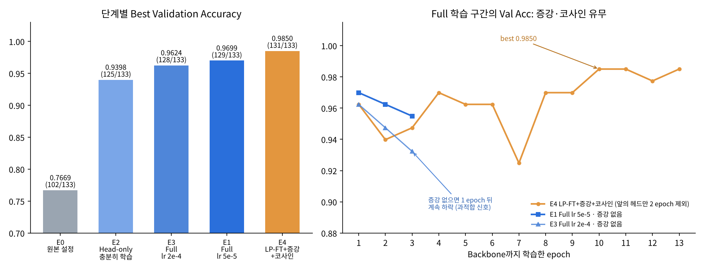
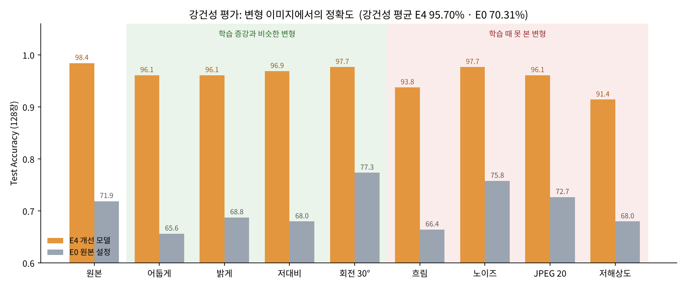

# 산출물 9. 성능 개선 실험 보고서 — 무엇이 약했고, 어떻게 고쳤나

제공 코드를 그대로 실행하면 Validation Accuracy가 **0.7669**에 그쳤습니다. 강사님께 "코드대로 하면 성능이 안 나온다"는 피드백을 받고, **원인을 하나씩 가설로 세운 뒤 실험으로 확인**하는 방식으로 개선했습니다.



**실험 원칙**

- 약점 ①·②는 한 번에 **하나만** 바꿔서 무엇이 효과를 냈는지 알 수 있게 했습니다. 약점 ④는 논문 근거가 있는 기법 여러 개를 **한꺼번에** 적용했습니다(아래 주의할 점 참고).
- 모든 실험은 **같은 데이터 분할**(Train 1,034 / Val 133)과 **같은 seed(42)**로 돌렸습니다.
- 모델 선택은 **Validation으로만** 하고, **Test(128장)는 최종 모델을 정한 뒤 한 번만** 씁니다.
- 원본 `training/finetune.py`는 **수정하지 않았습니다.** 옵션만 바꾸거나(약점 ①·②), 새 스크립트 `training/finetune_v2.py`를 따로 만들었습니다(약점 ③·④).

## 출발점 — 제공 코드 그대로 (E0)

```bash
python -m training.finetune --epochs 3 --batch-size 8 --freeze-backbone   # lr 0.0002 (기본값)
```

| epoch | 1 | 2 | 3 |
|---|---:|---:|---:|
| Train loss | 0.9924 | 0.8108 | 0.7078 |
| Val Acc | 0.6617 | **0.7669** | 0.7669 |

ResNet18의 Backbone(특징 추출부, 약 1,118만 개 파라미터)을 고정하고 **마지막 분류층 1,539개만** 학습하는 설정입니다.

## 약점 ① 학습이 덜 됐다 → 학습률 ↑, epoch ↑ (E2)

**왜 약점이라고 봤나요?**
3클래스를 아무렇게나 찍을 때 loss는 ln 3 ≈ 1.10입니다. 그런데 E0의 마지막 loss는 0.71로, 아직 계속 내려가는 중에 3 epoch에서 끝났습니다. 그리고 새로 만든 분류층은 랜덤 값에서 시작하는데, 기본 학습률 0.0002는 이걸 학습하기엔 너무 작습니다.

**바꾼 것:** 원본 스크립트에서 `--lr 0.001 --epochs 10`만 바꿨습니다.

**결과:** Val Acc **0.7669 → 0.9398** (+17.29%p). 과적합은 아니었습니다(loss와 Val Acc가 둘 다 일정 수준에서 멈춤).

> 💡 처음에는 "Backbone을 고정한 게 핵심 원인이고, 학습량을 늘려도 조금만 오를 것"이라고 예상했습니다. 하지만 학습량만 늘려도 **+17.29%p**나 올랐습니다. 다음 실험(E3)에서 Backbone 효과는 +19.55%p로 나와서, **두 원인이 비슷하게 컸다**는 것이 최종 결론입니다. 예상이 틀린 것도 그대로 기록했습니다.

## 약점 ② Backbone이 콩잎을 모른다 → Backbone까지 학습 (E3 · E1)

**왜 약점이라고 봤나요?**
Backbone은 ImageNet의 개, 자동차, 컵 같은 **일반 사물**로 학습된 상태입니다. 그래서 콩잎의 **갈색 각진 반점(각진잎반점병)과 주황색 포자(녹병)** 같은 미세한 차이를 뽑는 법은 배운 적이 없습니다. Backbone을 고정하면 이 특징 추출 방식이 바뀌지 않습니다. 고정된 특징보다 Fine-tuning이 대체로 더 높은 정확도를 낸다는 연구 결과도 있습니다(Kornblith et al., CVPR 2019).

**바꾼 것**

| 실험 | E0과 다른 점 | Best Val Acc |
|---|---|---:|
| E3 | `--freeze-backbone`만 뺌 (lr 0.0002 그대로) | 0.9624 (128/133) |
| E1 | 위 + 학습률 0.00005 (평가가이드 선택 실험 명령) | 0.9699 (129/133) |

**결과:** 학습률을 그대로 둔 E3로 비교하면 **Backbone 학습만으로 +19.55%p**입니다. 학습률을 낮춘 E1이 조금 더 좋았지만 차이는 1장입니다.

**새로 발견한 문제:** 두 실험 모두 **epoch 1이 최고였고 그 뒤로 Val Acc가 계속 떨어졌습니다**(E3: 128 → 126 → 124장). 학습 데이터는 점점 더 잘 맞추는데 처음 보는 데이터는 못 맞추게 되는, **과적합의 시작** 신호입니다.

**과적합이 얼마나 심한지 직접 확인:** E1 모델로 Train과 Val 정확도를 재 봤습니다.

| | 정확도 |
|---|---:|
| Train | 0.9961 (1030/1034) |
| Val | 0.9699 (129/133) |
| 차이 | 2.62%p → 아직 심하지는 않음 |

## 약점 ③ BatchNorm 통계가 학습 중에 흔들린다 → 코드 테스트로 확인

**왜 약점이라고 봤나요?**
`requires_grad=False`는 가중치만 고정합니다. 학습 중에 `model.train()`을 부르면 Backbone 안의 **BatchNorm 층은 평균·분산 통계를 계속 새로 계산**합니다. 배치가 8장뿐이라 이 통계가 많이 흔들립니다.

**확인한 방법:** 단위 테스트(`tests/test_training.py`)로 **"가중치를 얼려도 BN 통계는 바뀐다"는 것을 직접 확인**했고, 이를 막는 `--freeze-bn` 옵션을 만들었습니다.

**결과:** 가설은 맞았습니다. 다만 이 옵션이 **정확도에 주는 영향은 아직 실험하지 않았습니다.**

## 약점 ④ 과적합을 막는 장치가 없다 → LP-FT + 데이터 증강 + 코사인 학습률 (E4)

**왜 약점이라고 봤나요?**
원본 코드에는 데이터 증강도, 학습률을 줄이는 장치도 없습니다. 그래서 학습 이미지 1,034장을 그대로 반복해서 보고 외우기 시작합니다(약점 ②의 epoch 1 이후 하락).

**바꾼 것** (새 스크립트 `training/finetune_v2.py`)

| 기법 | 하는 일 | 근거 |
|---|---|---|
| **LP-FT** | 처음 2 epoch는 분류층만 학습하고, 그다음에 전체를 학습. 랜덤 분류층의 큰 기울기가 Backbone을 망가뜨리지 않게 함 | Kumar et al., ICLR 2022 |
| **데이터 증강** | 학습 이미지에만 반전·회전·밝기 변화를 줌. **병반 색이 진단 근거라 색상(hue)은 아주 조금만** 바꿈 | Beans 선행연구에서 증강 + Fine-tuning이 가장 좋았음 |
| **코사인 학습률** | 처음 1 epoch 동안 학습률을 천천히 올리고(warmup), 후반으로 갈수록 줄임 | Loshchilov & Hutter, ICLR 2017 |
| **계층별 학습률** | Backbone 0.00005(E1과 같음), 분류층은 20배인 0.001(E2에서 효과 본 값) | 1·2단계 결과 |
| **저장 기준 보완** | Val Acc가 같으면 Val loss가 더 낮은 epoch를 저장 (원본은 같으면 저장 안 함) | — |

```bash
python -u -m training.finetune_v2 --output artifacts/e4_lpft_aug_cosine \
  --epochs 15 --batch-size 8 --lp-epochs 2 --lr 0.00005 --head-lr-mult 20 \
  --augment --scheduler cosine --warmup-epochs 1 --patience 5
```

**결과:** Best Val Acc **0.9850 (131/133)**, Val loss 0.0559 — 전체 epoch 12에서 저장(그래프 오른쪽에서는 Backbone 학습 10번째 epoch)

- **과적합이 완화됐습니다.** 증강이 없던 E1·E3는 epoch 1 이후 계속 떨어졌지만, E4는 학습 후반으로 갈수록 오히려 올라가서 0.97~0.985에서 유지됐습니다. Val loss도 중간에 오르내림은 있었지만 전체적으로 0.113 → 0.044로 낮아졌습니다.
- **학습률이 줄자 출렁임이 사라졌습니다.** 학습률이 높은 초중반에는 0.92~0.97 사이로 출렁였는데, 학습률이 크게 줄어든 후반부터는 안정됐습니다.

## 5단계 — 최종 Test 평가 (128장, 1회)

**왜 하나요?** 여러 실험의 여러 epoch 중에서 Val 점수로 골랐기 때문에, Val 점수가 실제보다 높게 나왔을 수 있습니다. 한 번도 쓰지 않은 Test로만 이걸 확인할 수 있습니다.

**순서**
1. Val 기준 최고인 **E4를 최종 모델로 먼저 확정**했습니다(Test를 본 뒤에 고르지 않음).
2. 판단 기준을 **결과를 보기 전에** 정했습니다: Test 0.97 이상이면 "Val 점수가 부풀지 않음", 0.94 미만이면 "부풀었음".
3. E4의 Train/Val 차이를 먼저 확인했습니다: Train 0.9961(1030/1034), Val 0.9850 → **차이 1.11%p**(E1은 2.62%p).
4. `python -m training.evaluate`로 Test를 한 번 평가했습니다. E0는 비교용으로만 같이 쟀습니다.

| | Validation | **Test** | Val → Test |
|---|---:|---:|---:|
| **E4 (최종)** | 0.9850 (131/133) | **0.9844 (126/128)** | −0.06%p |
| E0 (원본 설정) | 0.7669 (102/133) | 0.7188 (92/128) | −4.81%p |

**E4 클래스별 (Test)**

| 클래스 | Precision | Recall | F1 |
|---|---:|---:|---:|
| angular_leaf_spot | 0.9767 | 0.9767 | 0.9767 |
| bean_rust | 0.9767 | 0.9767 | 0.9767 |
| healthy | 1.0000 | 1.0000 | 1.0000 |
| **Macro** | | | **0.9845** |

| 정답 \ 예측 | angular_leaf_spot | bean_rust | healthy |
|---|---:|---:|---:|
| **angular_leaf_spot** | 42 | 1 | 0 |
| **bean_rust** | 1 | 42 | 0 |
| **healthy** | 0 | 0 | 42 |

**틀린 2장**

| 파일 | 정답 → 예측 | 점수 | 메모 |
|---|---|---:|---|
| `angular_leaf_spot_test.14.jpg` | 각진잎반점병 → 녹병 | 0.9608 | 확신하고 틀림. E0도 같은 사진을 녹병으로 틀림 → 사진을 직접 확인해 볼 사례 |
| `bean_rust_test.15.jpg` | 녹병 → 각진잎반점병 | 0.5665 | 애매하게 틀림. E0도 틀린 어려운 사진 |

**결론:** 기준(0.97 이상)을 넘었으므로 **Val 점수가 부풀지 않았다**고 판단했습니다. 틀린 사진이 모두 두 병 사이였는데, Beans 선행연구에서도 두 병의 질감 · 색이 비슷해서 가장 많이 헷갈린다고 보고했습니다. E0는 36장을 틀렸고 대부분 점수 0.5 미만의 자신 없는 예측이었습니다.

## 6단계 — 강건성 평가 (Test 128장 × 변형 8가지)

**왜 하나요?** Test 사진은 학습 데이터와 같은 조건에서 찍었습니다. 실제로 휴대폰으로 찍으면 어둡거나, 흔들리거나, 화질이 나쁜 사진이 들어옵니다. 그래서 Test 사진에 일부러 변형을 주고 평가했습니다(`training/robustness.py`).

- **색조(hue) 변형은 넣지 않았습니다.** 병반 색이 진단 근거라서, 색을 바꾸면 정답 자체가 달라질 수 있습니다.
- 학습 증강과 **비슷한 변형(✅)**과 **학습 때 못 본 변형(❌)**을 나눠서 봤습니다. E4는 밝기 · 대비 · 회전 증강으로 학습했기 때문에 ✅ 쪽에서 유리한 게 당연합니다.
- 같은 사진에는 항상 같은 노이즈가 들어가게 고정해서 재현할 수 있습니다.



| 변형 | 비슷한 증강? | E4 | E4 변화 | E0 |
|---|:---:|---:|---:|---:|
| 원본 | — | 0.9844 | | 0.7188 |
| 어둡게 (밝기 ×0.6) | ✅ | 0.9609 | −2.35%p | 0.6562 |
| 밝게 (밝기 ×1.4) | ✅ | 0.9609 | −2.35%p | 0.6875 |
| 저대비 (대비 ×0.6) | ✅ | 0.9688 | −1.56%p | 0.6797 |
| 회전 30° (학습은 ±20°) | ✅ | 0.9766 | −0.78%p | 0.7734 |
| 흐림 (Gaussian r=2) | ❌ | 0.9375 | −4.69%p | 0.6641 |
| 노이즈 (σ=15) | ❌ | 0.9766 | −0.78%p | 0.7578 |
| JPEG 압축 (품질 20) | ❌ | 0.9609 | −2.35%p | 0.7266 |
| **저해상도 (1/4 축소 후 복원)** | ❌ | **0.9141** | **−7.03%p** | 0.6797 |
| **강건성 평균** | | **0.9570** | | 0.7031 |
| ✅ 평균 / ❌ 평균 | | 0.9668 / 0.9473 | | 0.6992 / 0.7070 |

**해석**
- 학습 때 못 본 변형에서도 **평균 0.9473**을 유지했습니다(원본 대비 −3.71%p).
- **가장 약한 변형은 저해상도와 흐림**입니다. 두 변형 모두 **작고 세밀한 무늬를 지우는데**, 각진잎반점병의 작은 반점과 녹병의 작은 포자가 바로 그런 무늬입니다. 반대로 노이즈는 무늬를 덮기만 해서 영향이 적었습니다(−0.78%p).
- E0는 일부 변형에서 원본보다 점수가 높게 나왔습니다(회전 0.7734 > 0.7188). 실력이 좋아진 게 아니라, 대부분을 점수 0.5 미만으로 애매하게 예측하는 **불안정한 모델이 흔들린 것**으로 봅니다.
- 다른 사람의 강건성 결과와는 **변형 종류와 강도가 달라서 직접 비교하지 않습니다.**

## 한눈에 보는 개선 단계

| 단계 | 실험 | 약점 → 대응 | Best Val Acc | 정답 수 |
|:---:|---|---|---:|---:|
| 0 | E0 | 제공 코드 그대로 | 0.7669 | 102 |
| ① | E2 | 덜 학습됨 → lr·epoch ↑ | 0.9398 | 125 |
| ② | E3 | Backbone 고정 → Backbone 학습 | 0.9624 | 128 |
| ② | E1 | + 학습률 ↓ | 0.9699 | 129 |
| ③ | — | BN 통계 흔들림 → 코드 테스트로 확인 | (실험 예정) | — |
| ④ | **E4** | 과적합 → LP-FT + 증강 + 코사인 | **0.9850** | **131** |
| 5 | E4 | 최종 Test 평가 | Test **0.9844** | 126/128 |
| 6 | E4 | 강건성 평가 (8가지 변형) | 평균 **0.9570** | — |

## ⚠️ 이 숫자를 읽을 때 주의할 점

- **Val이 133장이라 1장 차이가 0.75%p입니다.** E1 → E4의 +1.50%p는 2장 차이라서, 우연으로 생긴 차이일 수도 있습니다.
- 여러 실험의 여러 epoch 중에서 Val 점수로 골랐기 때문에 Val 점수가 부풀었을 수 있었는데, **Test(0.9844)로 확인한 결과 부풀지 않았습니다.**
- 모든 실험이 seed 하나(42)로 한 번씩만 돌린 결과입니다.
- **E4는 LP-FT · 증강 · 코사인 학습률 · 계층별 학습률을 한꺼번에 바꿨습니다.** 그래서 0.9850이 그중 어느 기법 덕분인지는 분리하지 못했습니다. 하나씩 빼 보는 실험(ablation)이 필요합니다.
- **서비스(API)에는 아직 E0 모델이 연결되어 있습니다.** 산출물 2~7의 API·성능 측정은 모두 E0 기준입니다.

## 다음에 할 일

- [x] E4를 최종 모델로 정하고 **Test 128장으로 1회 평가** → 0.9844
- [x] 비교용으로 E0도 Test 평가 → 0.7188
- [x] 강건성 평가 → 평균 0.9570
- [ ] 흐림 · 저해상도 증강을 추가하고, 다른 변형으로 다시 공정하게 평가
- [ ] `angular_leaf_spot_test.14.jpg`(확신하고 틀린 사진) 직접 확인
- [ ] seed를 바꿔 E4를 2번 더 학습해서 결과가 안정적인지 확인
- [ ] E4에서 기법을 하나씩 빼 보는 실험(ablation)으로 각각의 효과 확인
- [ ] `--freeze-bn`, label smoothing, MixUp의 효과 확인
- [ ] 서비스 모델을 E4로 바꾸고 API·성능 다시 검증


## 참고 논문

| 논문 | 이 프로젝트에서 참고한 점 |
|---|---|
| Kornblith, Shlens, Le. *Do Better ImageNet Models Transfer Better?* CVPR 2019 · [arXiv:1805.08974](https://arxiv.org/abs/1805.08974) | 고정된 특징보다 Fine-tuning이 대체로 정확도가 높다 → 약점 ② |
| Kumar et al. *Fine-Tuning can Distort Pretrained Features and Underperform Out-of-Distribution.* ICLR 2022 · [arXiv:2202.10054](https://arxiv.org/abs/2202.10054) | 분류층을 먼저 학습한 뒤 전체를 학습하는 LP-FT → 약점 ④ |
| Loshchilov & Hutter. *SGDR: Stochastic Gradient Descent with Warm Restarts.* ICLR 2017 · [arXiv:1608.03983](https://arxiv.org/abs/1608.03983) | 코사인 학습률 감소 → 약점 ④ |
| Mohanty, Hughes, Salathé. *Using Deep Learning for Image-Based Plant Disease Detection.* Frontiers in Plant Science 2016 · [doi:10.3389/fpls.2016.01419](https://doi.org/10.3389/fpls.2016.01419) | 식물 병해 분류에서 전이학습이 처음부터 학습하는 것보다 낫다 |
| Ochieng. *Transfer learning for classification of bean plant leaf diseases in precision agriculture.* University of Rwanda 석사논문 2022 · [링크](https://dr.ur.ac.rw/handle/123456789/1987) | 같은 Beans 분할(1035 / 133 / 128)에서 증강 + Fine-tuning이 가장 좋았음 → 약점 ④ |
| Zhang et al. *mixup: Beyond Empirical Risk Minimization.* ICLR 2018 · Müller, Kornblith, Hinton. *When Does Label Smoothing Help?* NeurIPS 2019 | `finetune_v2.py`에 옵션으로 구현 (효과는 아직 실험 전) |


## 원본 기록

| 실험 | 학습 기록 | 콘솔 로그 |
|---|---|---|
| E0 | `data/training_report.json` | `evidence/train_log.txt` |
| E1 | `data/training_report_full.json` | `evidence/train_log_full.txt` |
| E2 | `data/training_report_e2.json` | `evidence/train_log_e2.txt` |
| E3 | `data/training_report_e3.json` | `evidence/train_log_e3.txt` |
| E4 | `data/training_report_e4.json` | `evidence/train_log_e4.txt` |
| Test 평가 | `data/eval_test_e4.json` · `data/eval_test_e0.json` (+ `.md`) | `evidence/test_eval_e4_e0.png` · `evidence/test_eval_e0_misclassified.png` |
| 강건성 | `data/robustness_e4.json` · `data/robustness_e0.json` (+ `.md`) | `evidence/robustness_e4_e0.png` · `evidence/robustness_examples/` |

- 코드 테스트: `python -m pytest -q tests/test_training.py tests/test_robustness.py` → 10 passed
- E4 Train/Val 차이: Train 0.9961 · Val 0.9850 (`evidence/e4_train_val_gap.png`)
- 관련 문서: [산출물 1 Fine-tuning 결과보고서](01_FineTuning_결과보고서.md)
